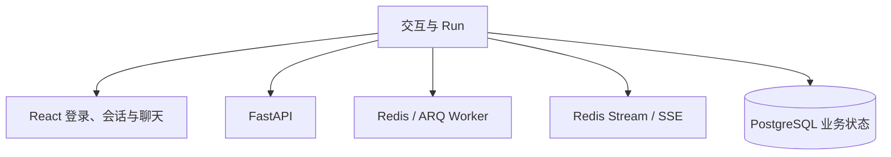
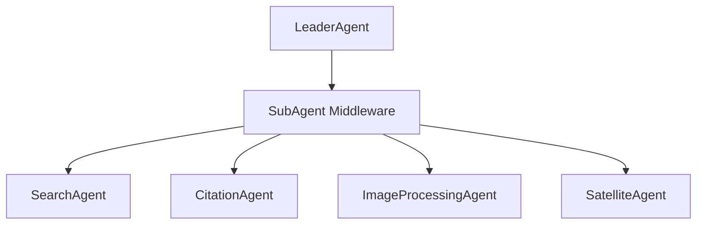
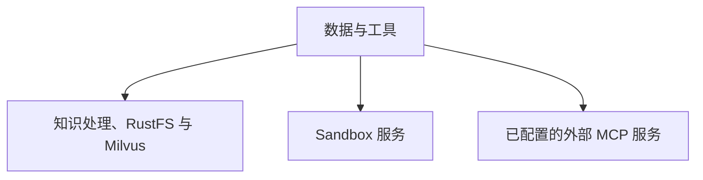
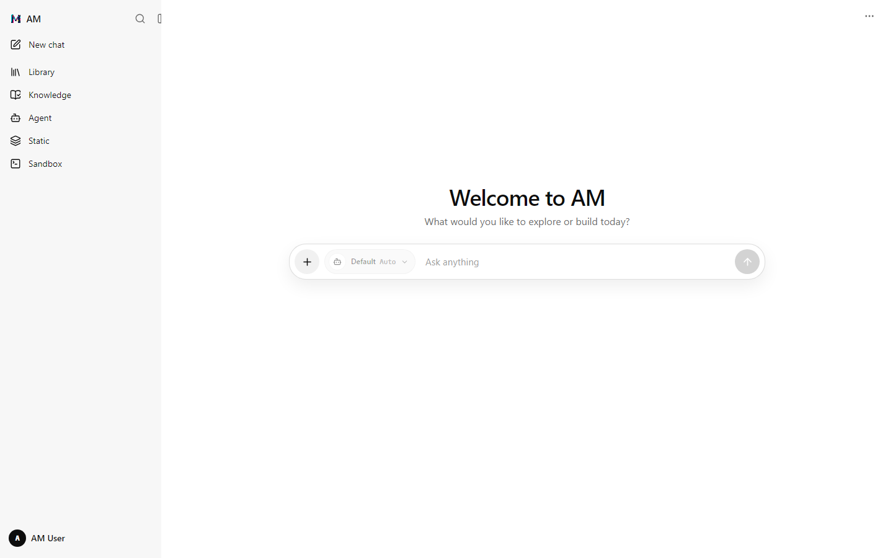
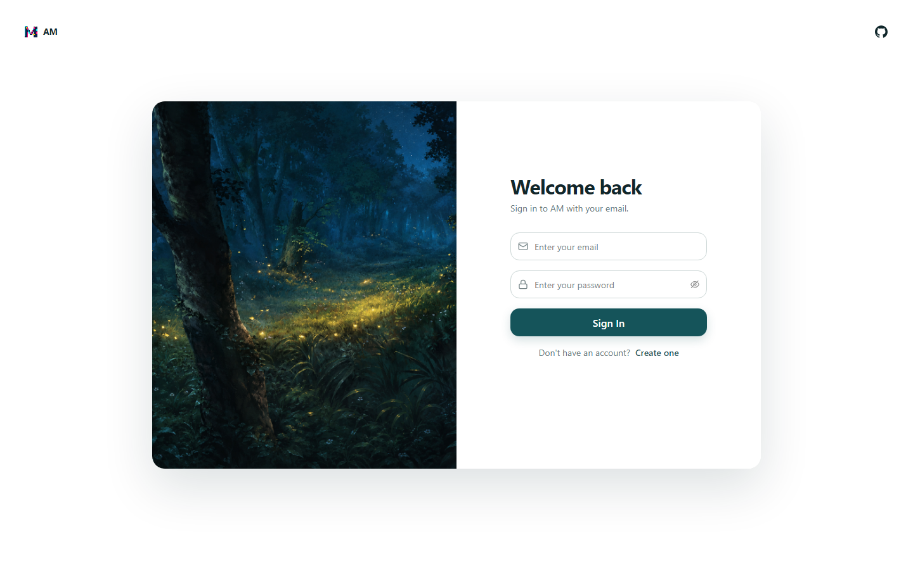

<!-- markdownlint-disable MD033 MD041 -->

<div align="center">


# agent-stack

基于 FastAPI、LangGraph 和 React 的多智能体应用，用于技术学习与工程实践。

</div>

## 当前系统

Web 端提供登录、会话和聊天界面。FastAPI 创建 Agent Run，Redis/ARQ Worker 执行任务，Redis Stream 承载运行事件并由 API 通过 SSE 返回给前端。PostgreSQL 保存用户、会话、消息和 Run 状态。

`LeaderAgent` 通过子智能体中间件委派任务，当前接入以下内部子智能体：

| 子智能体 | 当前职责 |
| --- | --- |
| `SearchAgent` | 网络与知识库检索 |
| `CitationAgent` | 核对回答声明与检索证据 |
| `ImageProcessingAgent` | 装配已配置的图像处理 MCP 工具，并校验工具返回的内嵌单帧图像能否完整解码 |
| `SatelliteAgent` | 通过已配置的 MCP 工具检索与分析卫星影像 |

知识模块负责文件解析、切块、索引与检索；RustFS 保存文件和解析产物，Milvus 保存向量索引。CubeSandbox 提供独立的工具与代码执行隔离，部署见 [CubeSandbox 指南](docker/cube/README.md)。MCP 服务需单独部署并在 `.env` 中配置，未配置时相应工具不可用。

## 系统结构

以下按职责展示当前已有模块。

### 交互与 Run



### Agent 编排



### 数据与工具



| 目录 | 职责 |
| --- | --- |
| `server/` | FastAPI 路由、业务服务和 ARQ Worker |
| `src/agents/` | LeaderAgent、子智能体、工具与中间件 |
| `src/knowledge/` | 文件处理和知识检索 |
| `src/database/`、`src/storage/` | 数据库仓储与基础设施适配 |
| `docker/cube/` | CubeSandbox 部署、预检和运行验收 |
| `web/` | React 前端 |
| `migrate/` | Alembic 数据库迁移 |
| `docker-compose.yml`、`docker/` | 服务编排与镜像配置 |

## 本地启动

需要 Python 3.13+、uv、Docker Compose 和 Node.js/npm。先把 `.env.template` 复制为 `.env`，填写实际使用的模型及外部工具配置：

```powershell
Copy-Item .env.template .env
uv sync
docker compose up -d postgres redis rustfs milvus
uv run --no-sync alembic upgrade head
docker compose up -d --build api worker
```

另开终端启动前端：

```powershell
cd web
npm ci
npm run dev
```

Compose 数据卷默认位于宿主机 `/var/lib/agent-stack/volume/`（通过 `AGENT_STACK_DATA_DIR` 配置），对象存储由 RustFS 提供。更多命令见[开发指南](docs/development.md)。

## 界面预览





## 文档

- [系统架构与模块边界](docs/architecture/README.md)
- [能力规格索引](docs/spec/README.md)
- [本地开发与验证](docs/development.md)
- [贡献规范](CONTRIBUTING.md)
