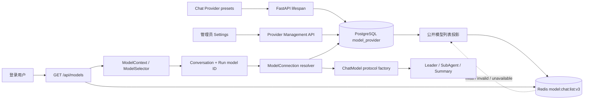
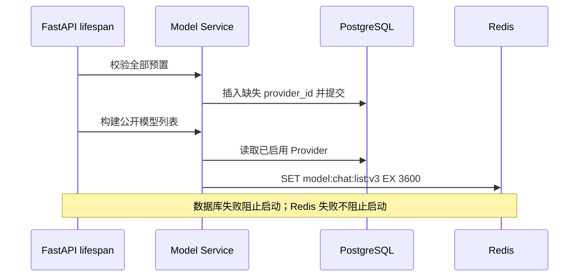

# Model System Architecture

## 1. Responsibility

Model System 管理平台级 Chat Provider、公开模型列表和单次 Run 的模型连接解析。
PostgreSQL 保存配置真相，Redis 缓存脱敏模型列表，Worker 创建仅在当前执行期间存在的 ChatModel。

具体合同见 [Model Provider Management](../spec/model/provider-management/spec.md)，页面行为见
[Settings 模型管理](../spec/product/model-settings/spec.md) 和
[Chat 模型选择](../spec/product/chat-model-selection/spec.md)。

## 2. 当前边界

全局表、预置补齐、管理员路由、数据库模型列表、缓存和 Agent 运行时已经接入。`/api/models` 从
PostgreSQL 投影并使用 Redis read-through cache；ChatModel 只由单次 Run 的 Provider 连接构造。
静态 Chat 目录和 `load_model()` 已移除，Embedding 与 Rerank 仍保留各自的配置路径。

当前拓扑：

## 3. Ownership

| 状态 | Owner | 生命周期 |
| --- | --- | --- |
| Provider 与连接参数 | PostgreSQL `model_provider` | 管理员写入，平台共享 |
| 公开模型列表 | PostgreSQL 投影；Redis 是副本 | 一小时 TTL，可随时重建 |
| Conversation 模型绑定 | PostgreSQL Conversation metadata | 对话级选择 |
| Run 模型快照 | PostgreSQL AgentRun metadata | 单次运行选择 |
| `ModelConnection` | Worker 内存 | 单次执行解析，不持久化 |
| LangChain ChatModel | Agent 执行内存 | 单次执行构造，不缓存 |

Provider 不绑定 User；所有登录用户读取同一模型列表。Provider 管理是管理员行为，管理员邮箱由部署配置
`ADMIN_EMAILS` 声明；浏览器只访问 FastAPI，不直接访问 Redis 或数据库。

代码模块的依赖方向为 `server/router -> server/entities + server/service -> src/model + Repository -> ORM`：

- `server/entities/model.py` 只拥有前后端 HTTP 请求与响应 DTO；
- `src/model/provider.py` 拥有 Provider 值类型、校验和 Service 写入命令；
- `src/model/runtime.py` 拥有 `ModelConnection` 与 `create_chat_model()`，不访问数据库；
- `server/service/model_service.py` 编排 DTO 映射、事务、连接解析和运行时构造入口；
- Repository 只处理 ORM，不依赖 DTO 或运行时对象。

## 4. Lifecycle

预置只提供首次插入值，不覆盖已保存记录。Provider 更新先提交 PostgreSQL，再删除并重建 Redis 列表；
刷新失败不回滚已提交配置，后续读取回源 PostgreSQL。

## 5. Runtime Boundary

公开模型 ID 统一为 `provider/model`，按第一个 `/` 切分，模型名称可以继续包含 `/` 或 `:`。
Run API 在写入快照前以 PostgreSQL 校验选择；Worker 执行时由 Model Service 重新解析当前 Provider 配置，
得到 `src/model/runtime.py::ModelConnection`，再通过同模块的协议工厂创建 ChatModel。Run、Context、Redis
和事件均不保存凭据或连接对象。

Agent 只消费显式传入的 ChatModel 和 `BaseContext.model` ID，不在构图过程中读取数据库、Redis 或环境中的
Chat Provider。静态 `load_model(model: str)`、Chat Provider 目录和旧目录缓存已经退役；Embedding 与
Rerank 继续由 Knowledge 相关配置拥有。
