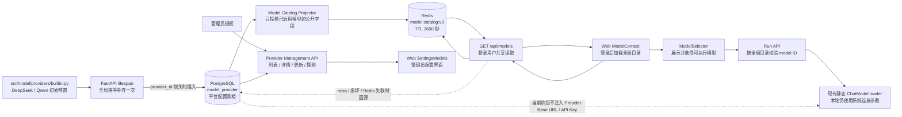
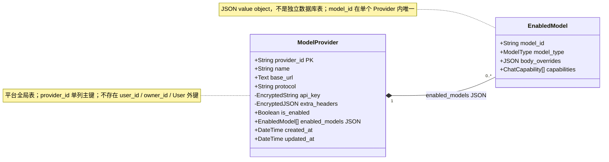
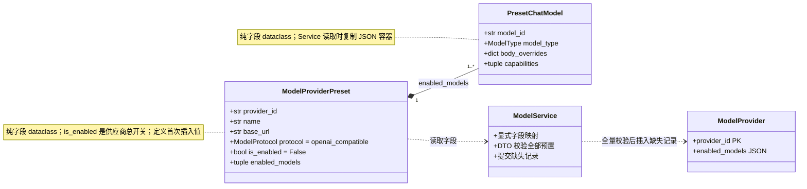
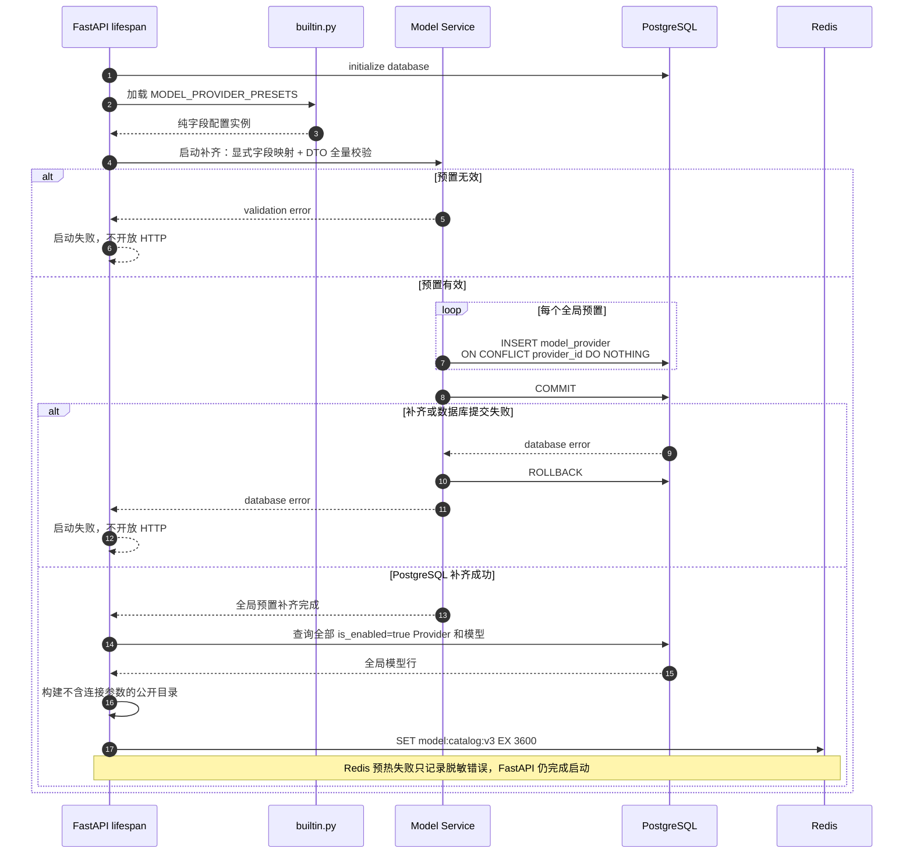
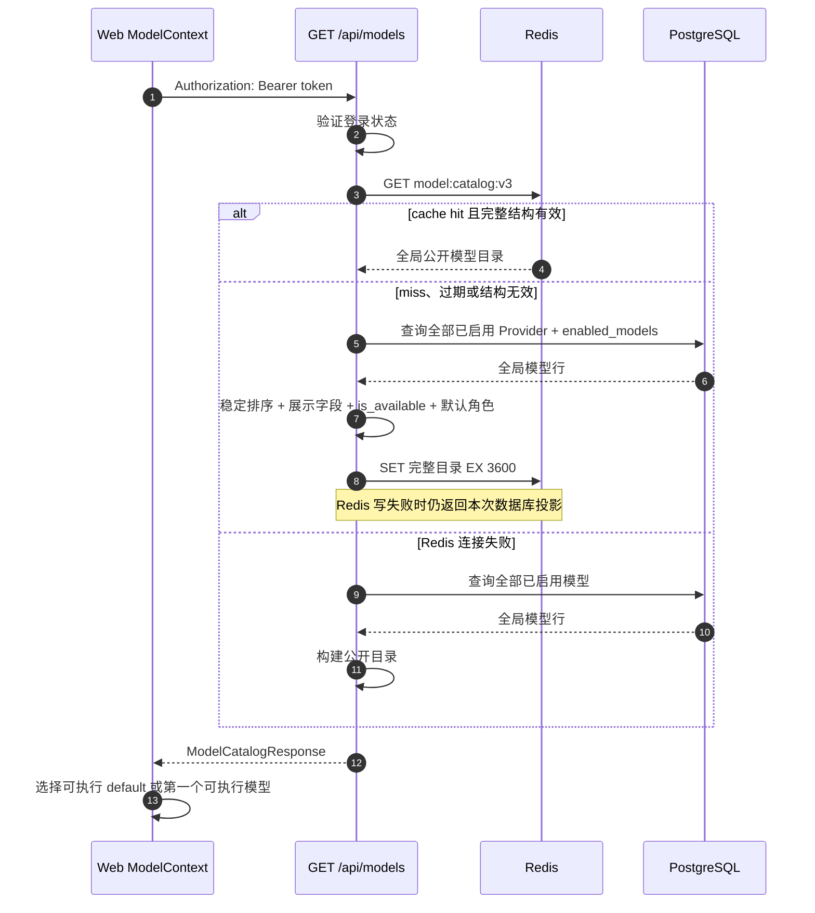
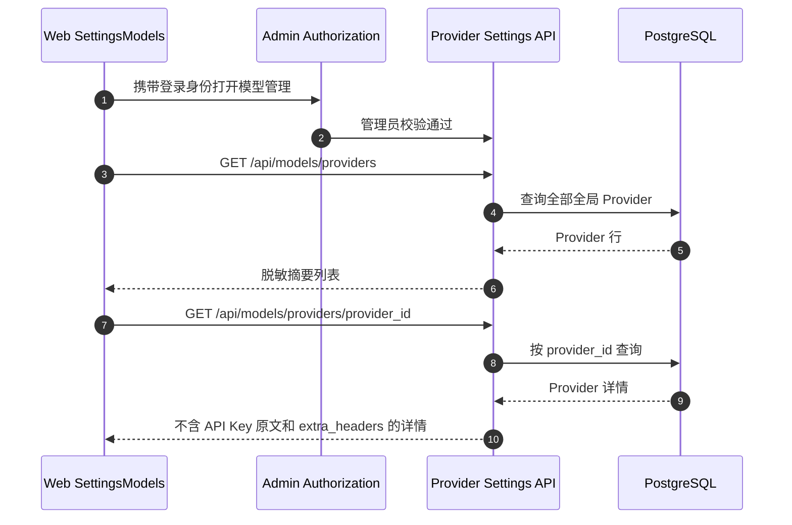
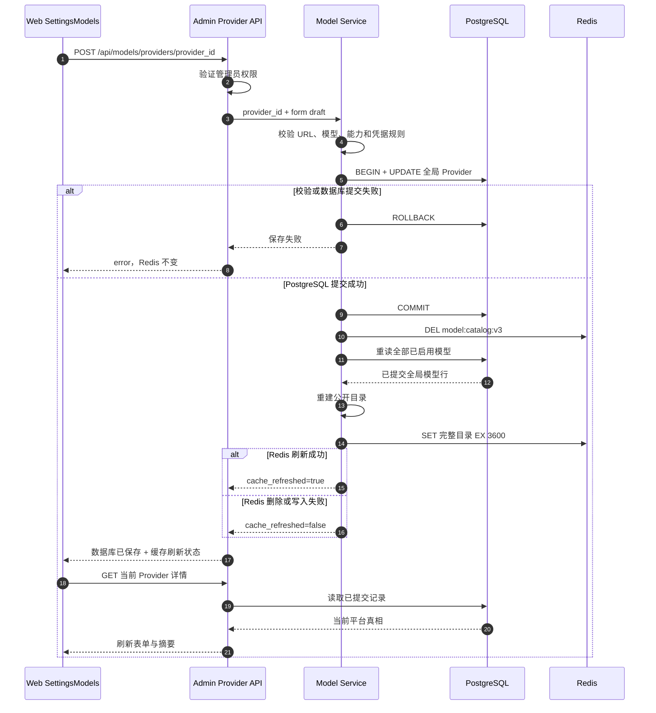

# Model System Architecture

## 1. Responsibility

定义平台级 Chat 模型供应商的初始预置、全局配置真相、Redis 模型目录和前端读取边界。
具体行为见 [Model Provider Management](../spec/model/provider-management/spec.md) 和
[Settings 模型管理](../spec/product/model-settings/spec.md)。

## 2. Overall Flow



`model_provider` 不绑定 User。所有登录用户看到同一份已启用模型目录；只有管理员能够修改平台 Provider。
浏览器只访问 FastAPI，不直接连接 Redis。Provider Settings 读取 PostgreSQL；Chat 模型目录读取全局
Redis 缓存。缓存 miss、过期、内容无效或 Redis 失联时，Service 从 PostgreSQL 重建。

### 2.1 Model Provider 字段模型



`api_key` 和 `extra_headers` 加密落库且不出现在任何外部响应；`has_api_key` 是读取时计算字段，不落库。
管理员摘要只返回 `provider_id`、`name`、`is_enabled`、`has_api_key`，详情另加 `base_url`、`protocol`、
`enabled_models`。字段类型、默认值与完整约束见
[MODEL-PROVIDER-001](../spec/model/provider-management/spec.md#model-provider-001-配置持久化)。

### 2.2 Preset 类与持久化映射



两个类的字段、默认值和 Service 映射 / 校验详见
[Preset 类定义](../spec/model/provider-management/plan.md#311-preset-类定义)。

## 3. FastAPI Startup



补齐以 `provider_id` 主键为幂等边界。多 API 进程同时启动时可以重复执行 ensure，数据库只保留一行；
已有行的名称、URL、启用状态、模型和凭据均不被代码预置覆盖。用户注册不参与 Model Provider 初始化。

## 4. Frontend Reads

### 4.1 登录后读取 Chat 模型目录



目录只包含前端渲染字段。预置供应商初始为 `is_enabled=false`，管理员启用至少一个供应商前，
Chat 得到合法空目录；前端不回退到硬编码模型。不同登录用户读取相同目录和默认值。

### 4.2 管理员打开 Provider Settings



Provider Settings 不读取 Chat 的 Redis 目录，因为编辑表单需要完整、最新的数据库状态；
`has_api_key` 只表示是否已保存密钥。普通用户不显示管理入口，也不能调用管理、探测或测试接口。

## 5. Provider Updates and Cache Consistency



远程模型发现和连接测试只使用当前管理员表单草稿发起显式探测，不保存数据库，也不刷新目录。
若 Redis 故障发生在旧 key 删除之前，Chat 目录可能保留旧值直到 3600 秒 TTL；Provider Settings
仍立即显示 PostgreSQL 新值，`cache_refreshed=false` 表示全局 Chat 缓存尚未确认更新。
Redis 持续不可用时，`GET /api/models` 直接从 PostgreSQL 返回当前投影。

## 6. Ownership

- `providers/builtin.py` 是全局 Provider “首次创建值”的唯一声明位置，不是已保存平台配置的平行真相。
- PostgreSQL `model_provider` 是平台唯一权威配置；管理员修改后不从代码预置反向覆盖。
- Redis 只保存已启用模型的公开选择器字段，不保存 Base URL、API Key、额外请求头、请求体覆盖或 ORM 对象。
- Web 只持有公开目录、脱敏 Provider 响应和未提交草稿，不成为配置真相。

## 7. Write Invariants

FastAPI 启动在数据库初始化后执行一次全局幂等补齐：每个 `provider_id` 只在记录缺失时插入。
用户创建、登录或删除不创建、不复制也不删除 Model Provider。

管理员写入按固定顺序执行：

```text
管理员鉴权 -> 验证请求 -> 更新 PostgreSQL -> COMMIT -> 删除全局目录 -> 从 PostgreSQL 重建 -> Redis SET + TTL
```

数据库提交失败时不发布缓存。提交成功后 Redis 刷新失败不回滚数据库，响应显式报告缓存未刷新；
Redis 失联期间读取回退数据库，遗留旧 key 最迟由 TTL 淘汰。

## 8. Authorization Dependency

Yuxi 对 Provider CRUD 使用管理员依赖，对模型目录读取使用普通登录用户依赖，本系统采用相同边界。
当前 `User`、JWT 和 `AuthenticatedUser` 尚无管理员角色，因此实施全局 Provider 写接口前，Auth Domain
必须先提供可信的管理员授权合同。不得把“已登录”直接等同于“可修改全局模型配置”。

## 9. Startup Failure Policy

- 预置校验失败或 PostgreSQL 补齐失败会阻止 FastAPI 完成启动。
- PostgreSQL 提交后的 Redis 预热失败只记录脱敏错误，不阻止 API 启动；缺失目录由读路径重建，遗留旧目录由 TTL 淘汰。
- 从预置中删除供应商不会删除数据库记录；既有记录只能通过管理员操作或明确迁移改变。

## 10. Boundaries

- 本链路只管理 Chat 供应商，不管理 Embedding 和 Rerank 配置。
- 预置只包含已有完整、可校验的初始配置；不为未确认供应商写入占位 URL 或虚构模型。
- 当前变更统一全局 Provider 与 Chat 输入区展示目录的数据来源；Agent 运行时模型实例构造仍遵循现行静态规格。
