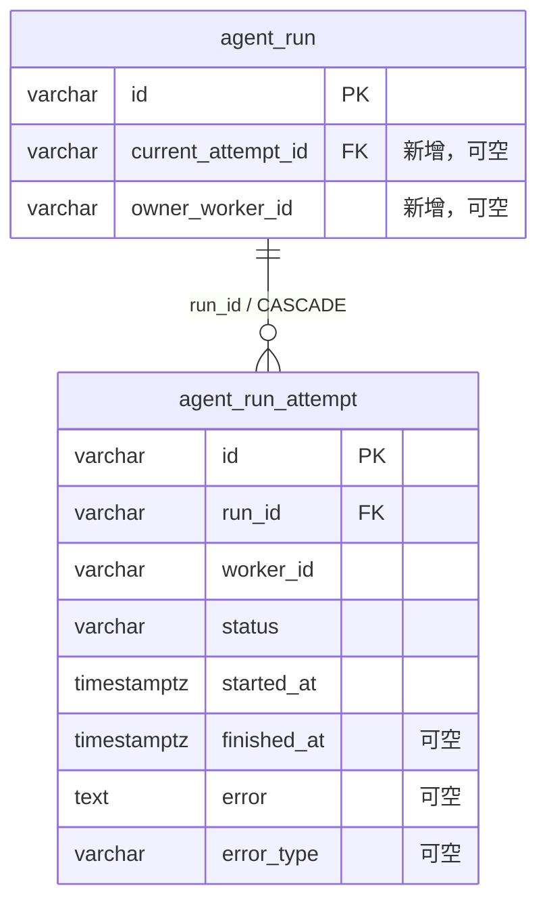

# Run 执行尝试表结构

本次仅增加数据库结构，不改变现有 Worker、队列、取消、重试、事件或结果写入流程。

## 表与字段

`AgentRun` / `agent_run` 新增两个可空字段，无默认值：

| 字段 | 类型 | 含义 |
| --- | --- | --- |
| `current_attempt_id` | `varchar(64)` | 当前执行尝试的标识 |
| `owner_worker_id` | `varchar(128)` | 当前执行 Worker 的标识 |

新增 `AgentRunAttempt` / `agent_run_attempt`：

| 字段 | 类型 | 可空 | 含义 |
| --- | --- | --- | --- |
| `id` | `varchar(64)` | 否 | 尝试主键，由未来写入方提供 |
| `run_id` | `varchar(64)` | 否 | 所属 Run |
| `worker_id` | `varchar(128)` | 否 | 这次尝试的 Worker 标识，不引用新 Worker 表 |
| `status` | `varchar(32)` | 否 | 尝试状态，由未来写入方提供；本次不定义状态流转 |
| `started_at` | `timestamp with time zone` | 否 | 开始时间，默认数据库当前时间 |
| `finished_at` | `timestamp with time zone` | 是 | 结束时间 |
| `error` | `text` | 是 | 错误信息 |
| `error_type` | `varchar(64)` | 是 | 错误类型 |

约束与索引：

- `attempt.run_id → run.id` 使用 `ON DELETE CASCADE`，删除 Run 时删除其尝试记录
- `UNIQUE (run_id, id)` 支持复合外键
- `run.(id, current_attempt_id) → attempt.(run_id, id)` 确保非空当前尝试属于同一个 Run
- 当前尝试仍被引用时不可单独删除；需先清空指针。反向外键使用默认 `NO ACTION`，不会清空 Run 主键
- `(run_id, started_at)` 索引支持按 Run 查询尝试历史
- 不限制一个 Worker 只能有一次尝试；不同尝试使用不同 `id`



## 迁移与兼容性

- Alembic revision：`0017_agent_run_attempt`，前置 revision：`0016_qwen_provider_id`
- 升级只建表、加字段、加约束与索引；不回填历史尝试，不改动已有 Run 状态或业务数据
- 旧 Run 的两个新字段保持 `NULL`；现有创建 Run 的调用不需要传新字段
- 已有数据库必须先运行 `uv run --no-sync alembic upgrade head`，再启动使用新 ORM 的 API/Worker；`create_all` 不会给已有表补列
- 降级 `uv run --no-sync alembic downgrade 0016_qwen_provider_id` 先解除反向外键，再移除新字段与新表；会丢弃未来写入的尝试历史与归属字段，应先备份这些数据
- ORM 的反向外键设置 `use_alter=True`，处理全新数据库建表时的双向引用顺序

## 本次能力边界

这些结构目前不会被运行流程自动填充。现有 Run 生命周期继续沿用 `agent_status`。
表结构本身不校验 `owner_worker_id` 与尝试的 `worker_id` 一致，不校验状态转换，
也不会阻止重复执行或过期 Worker 写入。领取、取消撤权、重试创建尝试及事件/结果
写入校验均尚未接入，不能将本次变更视为已实现并发隔离或 attempt fencing。

## 结构验证

```bash
uv run --no-sync python -m unittest discover -s test -p 'test_agent_run_attempt_schema.py' -v
uv run --no-sync python -m unittest discover -s test -p 'test_thread_message_persistence.py' -v
```

默认测试 SQLite 外键行为、迁移前后数据保留及 PostgreSQL 离线 DDL 顺序。
设置 `AGENT_STACK_SCHEMA_TEST_POSTGRES_URL` 为独立测试库的 SQLAlchemy PostgreSQL URL
（`postgresql+psycopg://...`）后，同一组结构及迁移测试也会在真实 PostgreSQL 上执行。
每个 PostgreSQL 测试使用独立 schema 并回滚整个事务；测试用户需要创建 schema 的权限。
未设置该变量时 PostgreSQL 实测会明确标为跳过，不代表通过。
