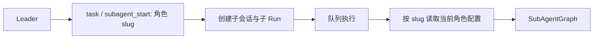
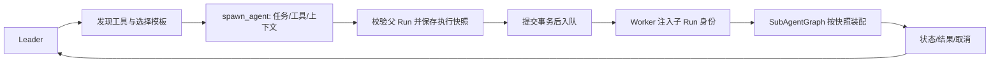

# 子 Agent 动态委派

## 1. 职责

Leader 按任务创建独立执行实例，分配工具和必要上下文；已有 SQL Agent 是可选配置模板。
每次执行使用统一 `SubAgentGraph`，通过 `AgentRun`、独立子会话和队列管理生命周期。

## 2. 模型可用工具

| 工具 | 输入 | 行为 |
| --- | --- | --- |
| `list_agent_tools` | 无 | 返回可分配工具名称和说明 |
| `spawn_agent` | `task`、可选 `tools` / `context` / `template` | 创建后台子 Run，返回 Run 与 Thread 标识 |
| `subagent_status` | `run_id` | 查询持久状态、进度及已完成结果 |
| `subagent_await` | `run_id` | 等待子 Run 结束并取得结果 |
| `subagent_cancel` | `run_id` | 按父运行作用域取消子 Run |

`task` 与 `subagent_start` 继续支持按角色 slug 委派已有模板，供既有工具调用消费。
模板目录为空时仍提供动态创建能力。

`spawn_agent` 的输入约定：

- `task: str`：非空任务说明，包括目标、边界与预期输出。
- `tools: list[str] | None`：明确选择工具名称；显式空列表表示无工具。
  省略时使用模板默认工具，无模板时使用空集合。
- `context: str`：任务所需的背景、证据及输入材料，保存为子任务输入的一部分。
- `template: str | None`：可选的启用子角色 slug，提供默认指令、模型和工具配置。

子任务不会自动继承父会话消息。工具参数不允许指定用户、父 Run 或子 Run 的身份。
同一批工具调用包含 `ask_user` 时拒绝新建子任务，返回可以反馈给模型的工具错误。

## 3. 创建与持久化

`SubAgentRunService.create_spawn_record()` 验证任务输入并锁定父 Run，要求属于当前用户、
仍在运行且不是子 Run。任务幂等键由父请求及工具调用身份派生。
模板配置复制后解析为本次运行配置，未知工具在子 Run 创建前拒绝。
取消请求先锁定并标记目标 Run，再查询和取消子树；并发 spawn 持有同一父 Run 行锁，
使取消方等待已开始的创建提交后再读取子任务。取消状态提交后才发布信号。

通用执行器由固定 `generic_agent` 记录承载；每次 spawn 创建独立的 Conversation、输入消息
和 AgentRun。`run_type="subagent"`、`created_by_run_id=<发起委派的 Run>`。
Run 元数据保存：

```python
{
    "tool_call_id": "...",
    "model": "已解析的模型标识",
    "spawn": {
        "template": None,  # 或模板 slug
        "agent_config": {
            "system_prompt": "...",
            "model": "已解析的模型标识",
            "tools": ["web_search"],
            # 其他本次执行的 Context 配置
        },
    },
}
```

配置快照不包含运行身份。Worker 从数据库中的子 Run 和用户重新注入 `uid`、`run_id`、
`thread_id`、`request_id` 及 `created_by_run_id`。事务提交后才投递 Run ID。
模板被修改后，已创建任务继续消费自己的配置快照。

## 4. 工具装配

`SubAgentContext.tools` 中的明确列表是本次运行实际可用的工具集合，`[]` 是零工具。
历史子 Run 未指定 tools 时沿用已有装配；spawn 在创建时解析为明确工具列表。
普通工具、MCP 工具和文件系统中间件注入的工具均受该集合约束。
目录查询列出全局已配置服务的 MCP 工具；具体子任务仍按所选模板的 `mcps` 配置解析工具。
工具目录提供名称和用途，实际执行仍通过已注册工具对象，不能由任务内容导入任意 Python 对象。
子执行器不安装委派中间件；Leader 负责创建及协调子任务。

## 5. 数据流

原有按角色委派：



动态任务委派：



## 6. 验收

- 无模板创建、模板默认配置和按次覆盖工具均可执行。
- 父上下文或模板的后续变化不污染已创建子任务配置。
- 显式空集合和未选工具在图执行中不会触发工具副作用。
- 原创建者、同会话恢复 Run 的状态查询及级联取消复用既有规则。
- 越权、父 Run 已结束、未知模板或工具被拒绝，失败不产生已入队的子任务。
- 同一工具调用重试不会重复创建子 Run，持久化先于队列通知。
