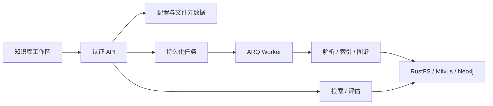

# 知识库工作区

## 目标

提供知识库创建与设置、文件组织、解析与索引、检索测试、图谱和质量评估的完整操作入口。
知识库与文件继续由当前用户拥有；PostgreSQL 保存配置和处理记录，RustFS 保存原文件与解析产物，
Milvus 保存向量，ARQ 执行批量处理。

## 能力合同

- 知识库可编辑名称、描述、解析方式、切块参数、Embedding 选择与检索配置。
- 已建立向量绑定后禁止切换 Embedding 模型；新索引必须使用该绑定。
- 文件支持文件夹组织、移动、重命名、批量上传、批量解析、索引、图谱抽取和删除。
- 原文件可下载，解析内容可预览；批量处理逐文件记录结果，刷新页面后仍能查看任务进度。
- 检索读取知识库保存的 Top-K、候选数、相似度阈值和重排设置，测试可以显式覆盖参数。
- 评估复用生产检索入口与既有检索评估器，提供逐问题结果、命中率、精确率、召回率及报告下载。
- 所有读写先验证知识库归属；跨库文件和文件夹不能被引用或操作。

## 数据和接口

`KnowledgeBase` 增加 JSON 配置；`KnowledgeFolder` 保存父子目录；`KnowledgeFile` 关联目录。
`KnowledgeTask` 保存批量操作类型、文件列表、进度、逐文件结果和终态。
现有 `/api/knowledge/bases` 接口继续使用，增加设置、目录、任务、下载与评估接口。

