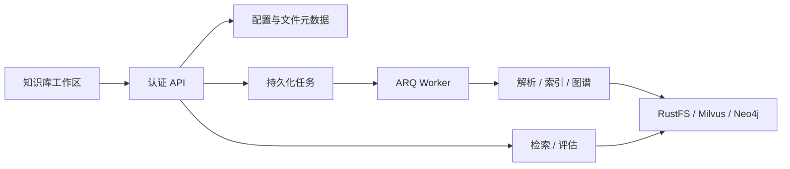
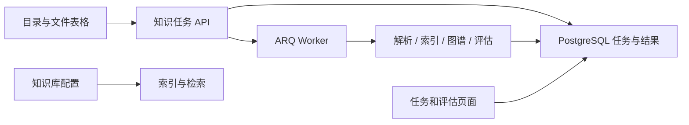

# 知识库工作区

## 目标

提供知识库创建与设置、文件组织、解析与索引、检索测试、图谱和质量评估的完整操作入口。
知识库与文件继续由当前用户拥有；PostgreSQL 保存配置和处理记录，RustFS 保存原文件与解析产物，
Milvus 保存向量，ARQ 执行批量处理。

## 能力合同

- 知识库可编辑名称、描述、解析方式、切块参数、Embedding 选择与检索配置。
- 已建立向量绑定后禁止切换 Embedding 模型；新索引必须使用该绑定。
- 文件支持文件夹组织、移动、重命名、批量上传、批量解析、索引、图谱抽取和删除。
- 原文件可下载，解析内容可预览；批量处理逐文件记录结果，刷新页面后仍能查看任务进度。
- 检索读取知识库保存的 Top-K、候选数、相似度阈值和重排设置，测试可以显式覆盖参数。
- 评估复用生产检索入口与既有检索评估器，提供逐问题结果、命中率、精确率、召回率及报告下载。
- 所有读写先验证知识库归属；跨库文件和文件夹不能被引用或操作。

## 数据和接口

`KnowledgeBase` 增加 JSON 配置；`KnowledgeFolder` 保存父子目录；`KnowledgeFile` 关联目录。
`KnowledgeTask` 保存批量操作类型、文件列表、进度、逐文件结果和终态。
现有 `/api/knowledge/bases` 接口继续使用，增加设置、目录、任务、下载与评估接口。

## 实现契约

`KnowledgeSettings` 保存切块方式、标题策略、Token 大小、Embedding 选择、Top K、候选数、相似度阈值与重排开关。
解析器按文件类型选择。切块设置由 `index_file` 读取；检索设置由 `search` 读取，测试请求可覆盖 Top K 与相似度阈值。
模型首次绑定以后，索引和检索始终使用 `KnowledgeEmbeddingBinding`。

`KnowledgeFolder` 以 `folder_id`、`kb_id`、`parent_id`、`name` 表示目录；更新在知识库行锁内校验父目录和环。
`KnowledgeFile.folder_id` 关联目录，重命名保留对象键与 Chunk ID。目录只有为空时可以删除。

`KnowledgeTask` 保存 `task_id`、`uid`、`kb_id`、`operation`、`status`、`payload`、`results`、`report` 和时间。
任务状态为 pending、running、completed、failed、cancelled；单个文件失败后仍处理其他文件。
取消会停止后续文件处理，正在执行的文件允许完成；Worker 结果保存在 PostgreSQL。
检索评估 payload 包含数据集标识、版本、候选 K 和带 Chunk ID 标注的问题，复用 `RetrievalEvaluator`。

| 接口（前缀 `/api/knowledge/bases/{kb_id}`） | 行为 |
| --- | --- |
| GET/POST `/settings` | 读取和保存配置 |
| GET/POST `/folders`，POST/DELETE `/folders/{folder_id}` | 目录管理 |
| POST `/files/{file_id}/metadata` | 文件移动和重命名 |
| GET `/files/{file_id}/download` | 下载原文件 |
| GET/POST `/tasks`，POST `/tasks/{task_id}/cancel` | 批任务和进度 |
| POST `/evaluations` | 创建持久化检索评估任务 |

改动前：

改动后：

