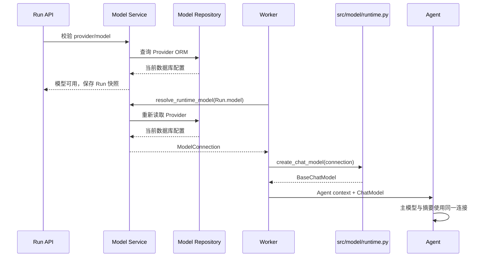

# 运行时连接

## 目标

让 Conversation 和 Run 中已有的模型 ID 真正选择 Provider 连接，使模型选择、连接参数和 Agent 执行只有一条链路。

## 实施

1. 新建 `src/model/provider.py`，承接 Provider 公共枚举、值对象、校验规则和 Service 写入命令；
   `src/model/providers/builtin.py` 改为引用这些类型，只负责预置数据。
2. 将 `server/entities/model.py` 收敛为 HTTP 请求与响应 DTO；这些 DTO 可以组合 Provider 公开值类型，
   但文件中不再定义 `ModelProviderCreate`、`ModelProviderUpdate` 或 `ModelConnection`。
3. 新建 `src/model/runtime.py`，定义 `ModelConnection` 和 `create_chat_model(ModelConnection)`；当前只注册
   `openai_compatible`，未知协议直接失败，工厂不读取数据库、Redis 或环境变量。
4. `resolve_runtime_model()` 保留在 `server/service/model_service.py`，改为按第一个 `/` 解析
   `provider/model`，通过 Repository 读取并校验 Provider，再返回 `ModelConnection`。
5. Run 创建在写入 Conversation / Run 前查询 PostgreSQL 验证模型，不使用 Redis 列表作为授权或连接真相。
6. `thread_service` 在普通 Run、子 Run 和 Resume 的共享入口按 Run 快照解析连接并创建 ChatModel。
7. LeaderAgent、SubAgentGraph、摘要中间件和知识抽取调用消费显式传入的 ChatModel；
   `BaseContext.model` 只保留可追踪的模型 ID。
8. 确认所有 Chat 调用不再引用旧入口后，删除 `DEFAULT_BASE_MODEL_PROVIER`、静态 Chat 目录投影和
   `load_model(model: str)`；`model_tool.py` 中的 Embedding、Rerank 解析与构造继续保留。

## 类型与调用边界

| 类型或函数 | 位置 | 使用者 |
| --- | --- | --- |
| `ModelSettingsRequest`、Provider 响应 DTO、`ConnectionTestResult` | `server/entities/model.py` | Router 与前端接口 |
| `EnabledModel`、`ProviderSettings`、`ModelProviderCreate`、`ModelProviderUpdate` | `src/model/provider.py` | Model Service 与预置映射 |
| ORM `ModelProvider` | `src/database/models.py` | Repository |
| `resolve_runtime_model()` | `server/service/model_service.py` | Run 创建校验与 Worker |
| `ModelConnection`、`create_chat_model()` | `src/model/runtime.py` | Worker 的单次执行 |
| `BaseChatModel` | LangChain 接口 | Leader、SubAgent、摘要和知识抽取 |

依赖只从接口与应用层指向 Model 领域和持久化层；`src/model` 不导入 `server.entities`，Repository 不接收
Pydantic 请求 DTO，Agent 不读取 Provider ORM。

## 时序

Provider 在 Run 入队后被停用、删除或移除模型时，Worker 以当前 PostgreSQL 状态拒绝执行；Run 保存选择快照，
不保存凭据或旧连接快照。

## 验证

- 模型 ID 包含额外 `/` 或 `:` 时正确解析。
- 未知、停用、已删除 Provider，缺失模型和未知协议产生确定性错误。
- 普通 Run、子 Run、Resume 和摘要使用解析后的同一 Provider 连接。
- HTTP DTO、Provider 领域类型、ORM 和运行时类型之间没有反向依赖；Repository 测试不需要构造 HTTP DTO。
- Run metadata、Context 序列化、事件、日志和异常文本不含凭据或私有请求头。
- 所有 Chat 调用方均通过运行时连接注入；静态 `load_model()` 与 `DEFAULT_BASE_MODEL_PROVIER` 已移除，Embedding 和 Rerank 行为不变。
