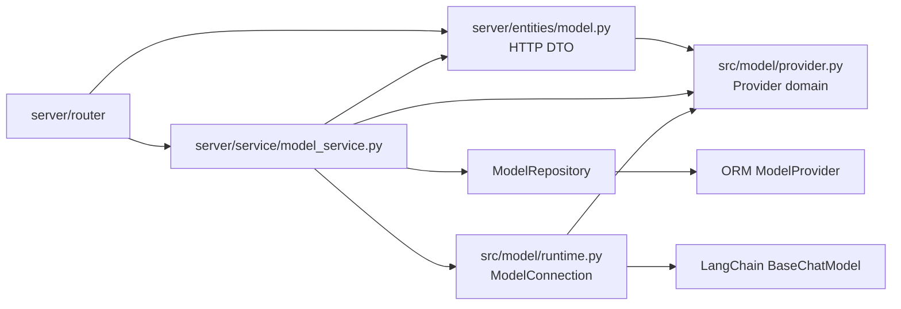
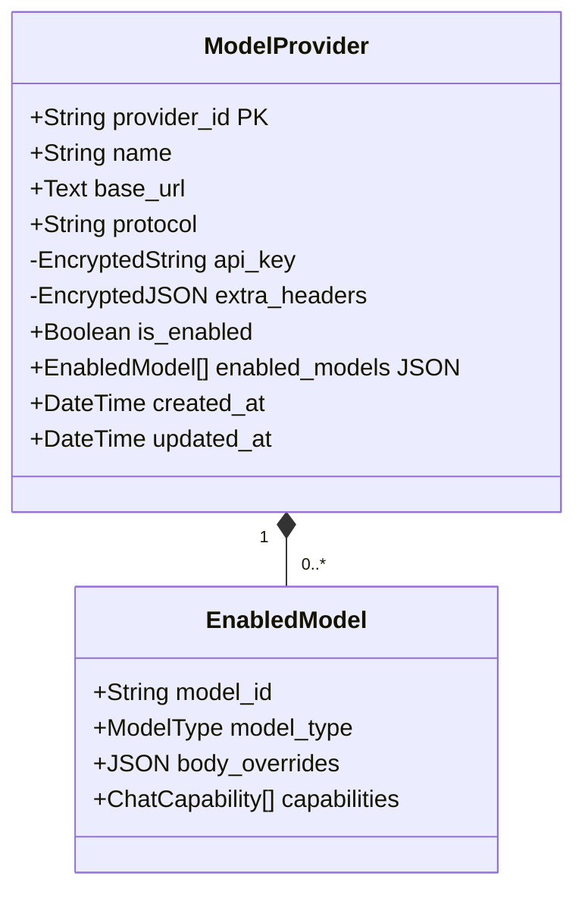
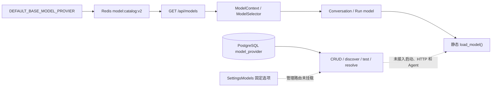
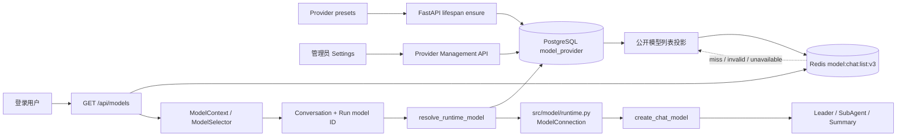
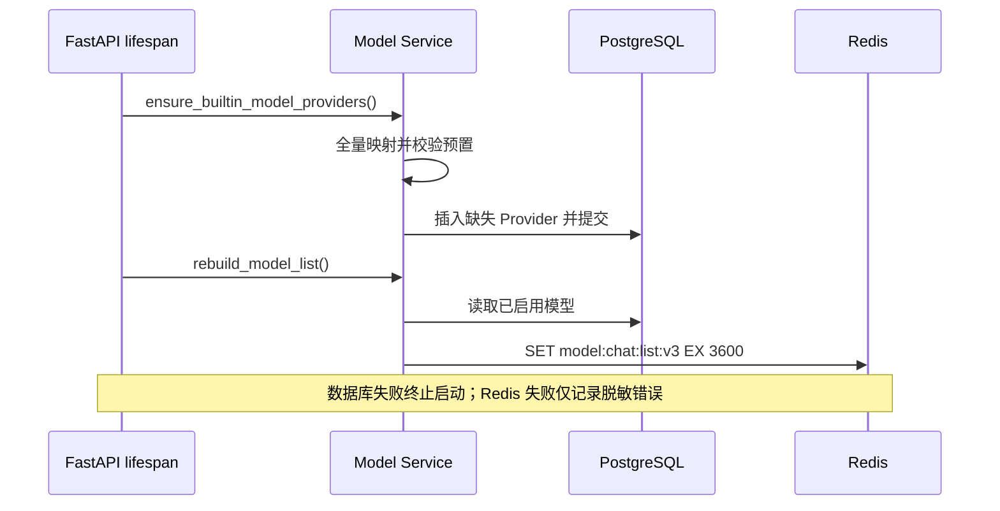

# Model Provider Management

## 1. 目标与现状

Model Provider 管理平台可执行的 Chat 模型、连接参数和公开模型列表。PostgreSQL 是配置真相；
Redis 只缓存脱敏模型列表；Run 只保存模型 ID；Worker 在执行时解析连接并创建运行对象。

当前代码边界如下：

| 能力 | 实现状态 | 合同 |
| --- | --- | --- |
| 全局 Provider 表与迁移 | 已实现 | `provider_id` 单列主键 |
| 预置、幂等补齐 | 已接入 lifespan | 启动时执行并预热模型列表 |
| CRUD、发现、测试 | 已挂载 | 只允许管理员访问 |
| 公开模型列表 | 已切换 | PostgreSQL 投影 + `model:chat:list:v3` |
| Settings | 已动态化 | 按管理 API 渲染未知或预置 Provider |
| Run 模型绑定 | 已接入 | Conversation、Run 和执行使用同一 `provider/model` |
| Agent 构造 | 已切换 | Provider 连接解析 + 协议工厂 |
| Python 类型归属 | 已拆分 | 传输、Provider 领域、ORM、运行时四层分开 |

Provider 是平台全局配置，不绑定 User。配置写入依赖 Auth Domain 的管理员身份；普通登录用户共享读取
同一模型列表。当前管理员身份由部署环境的 `ADMIN_EMAILS` 逗号分隔列表拥有，不写入 Provider 或 JWT。

## 2. 数据与类型合同

### 2.1 模块归属

| 模块 | 类型或职责 | 依赖边界 |
| --- | --- | --- |
| `server/entities/model.py` | `ModelSettingsRequest`、`SettingsModel`、`ModelProviderSummary`、`ModelProviderResponse`、`ProviderWriteResult`、`ConnectionTestResult` | 只描述 HTTP 请求与响应；可以引用 Provider 公开值类型 |
| `src/model/provider.py` | `ProviderId`、`ChatCapability`、`ModelProtocol`、`ModelType`、`EnabledModel`、`ProviderSettings`、`ModelProviderCreate`、`ModelProviderUpdate`、`ModelSummary` | Provider 领域校验、Service 写入命令和内部读模型；不导入 `server`、Repository 或 ORM |
| `src/model/runtime.py` | `ModelConnection`、`create_chat_model()` | 单次运行连接和协议工厂；只依赖 Provider 值类型与 LangChain 接口，不访问数据库 |
| `src/database/models.py` | ORM `ModelProvider` | 数据库存储结构，不作为接口响应或运行时参数对象 |
| `src/database/repositories/model_repository.py` | Provider ORM 查询、写入与 `flush` | 接收 Service 映射后的 ORM 字段；不依赖 HTTP DTO、Provider 命令或 `ModelConnection` |
| `server/service/model_service.py` | 用例编排、事务、投影、`resolve_runtime_model()` | 组合传输 DTO、Provider 领域类型、Repository 和运行时连接，不把 ORM 传给 Router |

目标依赖方向为：



`server/entities` 相当于接口层传输模型，不承载数据库实体或 ChatModel 构造。`ModelProviderCreate` 和
`ModelProviderUpdate` 是 Service 使用的领域命令，不是 DAO 参数；Service 完成校验并映射为 ORM 字段后才调用
Repository。`src/model/providers/builtin.py` 只保留预置数据类和预置值，并从 `src/model/provider.py` 引用公共枚举与值类型。

### MODEL-PROVIDER-001 Provider 持久化



`model_provider` 的字段合同：

| 字段 | 约束 |
| --- | --- |
| `provider_id` | `^[a-z0-9_-]+$`，平台唯一，创建后不修改 |
| `name` | 去除首尾空白后的非空展示名 |
| `base_url` | 无用户信息、query 和 fragment 的 HTTP(S) 根地址，去掉末尾 `/` |
| `protocol` | 当前为 `openai_compatible` |
| `api_key` | `MODEL_CREDENTIAL_KEY` 加密落库，允许空字符串，永不回传 |
| `extra_headers` | 整体加密落库，永不回传或进入 Redis |
| `is_enabled` | 控制整个 Provider 是否进入模型列表并允许运行时解析 |
| `enabled_models` | Chat 模型 JSON 数组，同一 Provider 内 `model_id` 唯一 |

`EnabledModel` 严格包含：

| 字段 | 类型 | 约束 |
| --- | --- | --- |
| `model_id` | `string` | 非空，无首尾空白和控制字符 |
| `model_type` | `ModelType` | `deepseek`、`qwen`、`glm`、`minomax`、`gemini`、`chatgpt`、`ollama`、`vllm` |
| `body_overrides` | JSON object | 有限 JSON；不接受连接、消息、模型 ID 和流控制字段 |
| `capabilities` | `ChatCapability[]` | `chat`、`vision`、`reasoning`、`tools`、`code`、`audio`、`video`，不重复 |

Repository 只做以 `provider_id` 为边界的查询和 `flush`；Service 拥有校验、事务提交、回滚及提交后的
缓存刷新。外部接口使用 DTO，不直接序列化 ORM。

### MODEL-PROVIDER-002 预置

`PresetChatModel` 和 `ModelProviderPreset` 是 `src/model/providers/builtin.py` 中的冻结字段类：

```python
@dataclass(frozen=True, slots=True, kw_only=True)
class PresetChatModel:
    model_id: str
    model_type: ModelType
    body_overrides: dict[str, JsonValue] = field(default_factory=dict)
    capabilities: tuple[ChatCapability, ...] = ()


@dataclass(frozen=True, slots=True, kw_only=True)
class ModelProviderPreset:
    provider_id: str
    name: str
    base_url: str
    enabled_models: tuple[PresetChatModel, ...]
    protocol: ModelProtocol = "openai_compatible"
    is_enabled: bool = False
```

Service 先把全部预置映射为 `src/model/provider.py::ModelProviderCreate` 并完成全量校验，再开始写库。插入使用
`ON CONFLICT (provider_id) DO NOTHING`；已存在记录的名称、地址、开关、模型和凭据保持不变。

首批预置是 DeepSeek 和 Qwen。组合模型 ID 沿用现有 Run 的 `provider/model`，因此 Qwen 预置的
`provider_id` 使用现有运行前缀 `dashscope`，展示名仍为 `Qwen`，模型条目的 `model_type` 仍为 `qwen`。
迁移 `0016_qwen_provider_id` 将已存在的 `qwen` Provider 行显式改名为 `dashscope`；两者同时存在时
迁移停止并要求确定保留来源。

### MODEL-PROVIDER-003 模型 ID

公开列表、Conversation、Run 和运行时解析统一使用 `provider/model`。解析只切分第一个 `/`：

```python
provider_id, separator, model_id = model_ref.partition("/")
```

`provider_id` 不包含 `/`，`model_id` 可以继续包含 `/` 或 `:`。例如：

- `dashscope/qwen3.8-max` → Provider `dashscope`，模型 `qwen3.8-max`；
- `siliconflow/org/model-name` → Provider `siliconflow`，模型 `org/model-name`；
- `ollama/qwen3:8b` → Provider `ollama`，模型 `qwen3:8b`。

## 3. HTTP 与公开数据合同

### MODEL-PROVIDER-004 管理接口

| Method | Path | 身份 | 响应 |
| --- | --- | --- | --- |
| `GET` | `/api/models` | 登录用户 | `ChatModelListResponse` |
| `GET` | `/api/models/providers` | 管理员 | `ModelProviderSummary[]` |
| `GET` | `/api/models/providers/{provider_id}` | 管理员 | `ModelProviderResponse` |
| `POST` | `/api/models/providers/{provider_id}` | 管理员 | `ProviderWriteResult` |
| `POST` | `/api/models/providers/{provider_id}/discover` | 管理员 | `SettingsModel[]` |
| `POST` | `/api/models/providers/{provider_id}/test` | 管理员 | `ConnectionTestResult` |

`ModelProviderSummary` 返回 `provider_id`、`name`、`is_enabled`、`has_api_key`；详情增加 `base_url`、
`protocol` 和 `enabled_models`。`api_key` 与 `extra_headers` 不出现在响应中。

`ModelSettingsRequest` 接受 `base_url`、可省略的 `api_key`、`is_enabled` 和 `models`。Base URL 不变时，
省略 Key 表示保留旧值；地址改变时必须同时提供 Key，且旧私有请求头不带到新地址；显式空字符串表示清除。

### MODEL-PROVIDER-005 公开模型列表

`ChatModelListResponse` 保持现有 JSON 外形：

```text
default_model: string
fallback_model: string
flash_model: string
image_model: string
models: ChatModelItem[]
```

每个 `ChatModelItem` 包含 `id`、`name`、`display_name`、`version`、`provider`、`icon`、
`is_available`、`is_default`、`is_fallback`、`is_flash`。只投影 `is_enabled=true` 的 Provider；
Provider 按 `provider_id` 排序，单个 Provider 内保留 `enabled_models` 的保存顺序。

`is_available` 表示当前协议工厂能够构造该模型。应用默认模型存在且可执行时继续使用；否则选择第一个
可执行模型；没有可执行模型时返回空字符串。Fallback 和 Flash 只在对应 ID 可执行时保留。

Redis key 为 `model:chat:list:v3`，TTL 为 3600 秒。缓存值通过完整响应 DTO 解码，只包含上述公开字段。
缓存缺失、过期、结构无效或 Redis 不可用时从 PostgreSQL 构建并返回；Settings 列表和详情始终直接读取
PostgreSQL。

## 4. 服务与运行时合同

### MODEL-PROVIDER-006 配置解析与协议工厂

```python
# server/service/model_service.py
async def resolve_runtime_model(
    db: AsyncSession,
    model_ref: str,
) -> ModelConnection: ...


# src/model/runtime.py
def create_chat_model(connection: ModelConnection) -> BaseChatModel: ...
```

`resolve_runtime_model()` 要求 Provider 已启用且模型存在，返回 `provider_id`、`model_id`、`model_type`、
`protocol`、`base_url`、`api_key`、`extra_headers` 和 `body_overrides`。Secret 字段不参与默认 repr 或日志。

`ModelConnection` 定义在 `src/model/runtime.py`，是 Worker 单次执行使用的内部值对象。它不属于 HTTP 响应，
不进入 Repository，也不由 Agent 自行解析；只有 Model Service 可以根据 PostgreSQL 配置创建它。

`create_chat_model()` 只按 `protocol` 分派。`openai_compatible` 使用一个 OpenAI-compatible ChatModel 适配器，
显式传入模型、Base URL、API Key、请求头和请求体覆盖；未知协议立即失败。Provider 名称和
`model_type` 不参与协议选择。该函数不查询数据库、不读取 Redis 或环境变量，因此可以独立测试每种协议的参数映射。

Conversation 和 Run 只持久化 `provider/model`。Worker 在执行开始时从 PostgreSQL 解析连接并创建
ChatModel，然后把运行对象传给 Leader/SubAgent 构造和摘要中间件；`BaseContext.model` 继续只保存模型 ID。

### MODEL-PROVIDER-007 远程发现与连接测试

发现和测试使用管理员当前表单草稿请求 `GET {base_url}/models`。发现只返回合法、去重且未被上游明确
标记为非 Chat 的候选；保存由管理员明确选择的模型。测试验证目录请求，不修改数据库。

出站请求校验全部 DNS A/AAAA 结果，连接固定到本次校验的公网地址，原域名用于 Host 和 TLS SNI；
请求启用证书校验、关闭环境代理、自动重定向和无界重试。错误只返回脱敏类别、耗时和可用的 HTTP 状态码。

## 5. 流程

### 5.1 改动前



### 5.2 改动后



### 5.3 启动与写后刷新



Provider 保存先提交 PostgreSQL，再删除并重建模型列表。数据库回滚不触碰 Redis；Redis 刷新失败时
返回 `cache_refreshed=false`，已提交配置保持有效，后续读取通过 PostgreSQL 自愈。

## 6. 验收

- 预置补齐幂等且不覆盖已保存配置；无效预置在首条写入前失败。
- Provider 管理接口只允许管理员，模型列表只要求登录；前端入口遵循同一身份边界。
- PostgreSQL、Redis 命中、缓存重建和 Redis 故障得到等价的公开模型列表。
- Settings 供应商来自 API，未知 Provider 仍可显示，密钥只以 `has_api_key` 表示。
- HTTP DTO、Provider 领域命令、ORM 和运行时对象遵守模块归属；`src/model` 不依赖 `server`，Repository 不依赖 DTO。
- Conversation、Run、Provider 解析和 Agent 构造使用同一 `provider/model`，模型 ID 中的 `/` 与 `:` 被保留。
- 普通 Run、子 Run 和 Resume 使用 Run 模型 ID 解析同一全局连接；执行时不回退静态 Chat 配置。
- 发现、测试、缓存、响应、日志和事件不泄露 API Key、额外请求头或完整连接对象。
