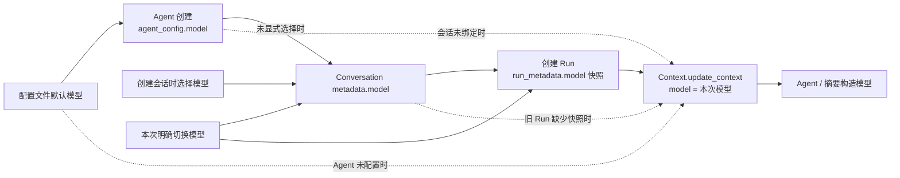

# Chat 全局模型列表

计划版本：v0.2.0

## 1. 目标

保留现有 Chat 选择器和 Run metadata，把 `/api/models` 与 ChatModel 构造统一到全局
`model_provider`。Redis 继续做 read-through cache，所有登录用户读取同一个 key 和模型列表。

供应商预置、数据库补齐和写后刷新由
[`provider-management`](../../model/provider-management/plan.md) 负责；本计划只展开目录 API、选择器和 Run 校验。

### 当前实现状态

会话与 Agent 模型绑定、PostgreSQL 模型列表、Redis read-through cache 和 Provider 运行时连接均已接入。
创建会话将模型写入 `conversation_metadata.model`；注册 Agent 将预置模型或应用默认模型写入
`agent_config.model`；普通 Run 创建时解析选择并保存模型快照。显式选择更新会话绑定，并与消息和 Run 一起提交。
子会话按子 Agent 配置绑定模型，Resume 保留父 Run 的模型快照。
执行入口从 PostgreSQL 解析 Run 模型对应的连接，构造 ChatModel 并注入 Agent；Context 只保留可追踪的模型 ID。



前端创建对话携带选中的模型，加载详情时恢复已有绑定。后端在数据库写入前校验解析得到的模型，
已有 Run 使用自己的快照，后续会话或 Agent 配置修改只影响新的 Run。

## 2. 后端数据流

```text
GET /api/models + AuthenticatedUser
  -> GET model:chat:list:v3
     -> 命中且完整结构有效：返回模型列表
     -> 未命中/损坏：查询全局 PostgreSQL model_provider
        -> 仅投影 is_enabled provider + enabled_models
        -> 计算公开展示字段、角色和协议工厂可用性
        -> Redis SET EX 3600
        -> 返回模型列表
     -> Redis 失联：直接返回 PostgreSQL 投影
```

`server/service/model_service.py` 读取全局 Repository，承担公开 DTO 投影、展示字段、角色解析和
Redis read-through 编排；缓存内容通过 `ChatModelListResponse` 完整校验。
Router 为 `/api/models` 保留登录认证和数据库 session，不接收或传播 user_id。

模型列表采用 `provider/model`，并与 Provider 运行时解析共用同一格式。可用性由协议工厂支持情况决定，
不通过发起网络请求判断；无法构造的条目标记为不可用。

## 3. 默认值和空列表

- 系统 `default_model` 若位于全局可执行模型列表则沿用，否则选第一个可执行项。
- `fallback_model`、`flash_model`、`image_model` 仅在对应配置位于可执行模型列表时返回，否则为空字符串。
- 模型项的角色布尔值从上述最终值计算，不允许顶层与列表标记不一致。
- 平台没有启用模型或没有可执行模型时返回合法空列表；API 不回退静态配置，也不虚构选项。

## 4. 前端和账号边界

`ModelContext` 继续在登录后调用 `/api/models`。access token 变化时先清空模型和选择，
并通过取消标记或请求代次丢弃登出前的迟到响应。默认选择只接受目录中 `is_available=true` 的项；
没有可执行模型时选择值为空，Composer 显示既有空状态并禁止提交带模型的 Run。

现有 `ModelSelector` 继续以文本菜单渲染服务端模型列表，不按前端品牌白名单过滤；
不可执行项可见但禁用，未知 provider 仍展示服务端名称和版本。

## 5. Run 校验

创建 Run 时从 PostgreSQL 校验模型 ID，只接受存在且可由协议工厂构造的模型。
通过后更新会话绑定并保存 Run 模型快照；Worker 按快照解析 `ModelConnection` 并创建 ChatModel，
`BaseContext.model` 继续保存可追踪的模型 ID。

## 6. 验证

- 模型列表投影：仅启用项、稳定顺序、展示字段、角色回退、空列表和不可执行模型。
- 缓存：全局 key、hit、miss、损坏、TTL、Redis 失联和管理员提交后失效。
- API/Run：必须认证、所有用户列表一致、拒绝不存在或不可用 ID、Run metadata 保持兼容。
- 前端：账号切换、迟到响应、默认项、空列表、未知图标和运行期间禁用。
- 执行后端定向测试、前端 typecheck/lint/test/build 及 `git diff --check`。

### 当前改造验证结果

- Provider、缓存、授权、Run / Resume、子会话和知识调用链的 66 项后端定向测试通过。
- Settings、认证与模型列表相关的 14 项前端测试通过。
- TypeScript、ESLint、生产构建、定向 Ruff、后端语法编译和 `git diff --check` 通过；
  生产构建仍有既有的大 chunk 提示。
- Alembic 当前只有 `0016_qwen_provider_id` 一个 head；目标 PostgreSQL 迁移、真实供应商凭据和完整启动链路
  仍需在依赖服务可用的部署环境验收。
