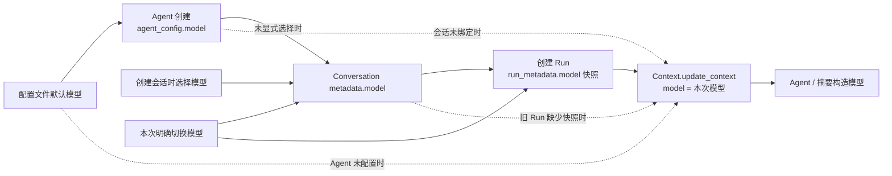

# Chat 全局模型目录

计划版本：v0.2.0

## 1. 目标

保留现有 Chat 选择器、Run metadata 和静态模型构造边界，把 `/api/models` 从全局代码配置目录改为
全局 `model_provider` 数据库投影。Redis 继续做 read-through cache，所有登录用户读取同一个 key 和目录。

供应商预置、数据库补齐和写后刷新由
[`provider-management`](../../model/provider-management/plan.md) 负责；本计划只展开目录 API、选择器和 Run 校验。

### 本次实施切片：会话与 Agent 模型绑定

当前先交付模型绑定与 Context 组装，模型目录及连接参数继续使用现有配置文件。
创建会话将模型写入 `conversation_metadata.model`；注册 Agent 将预置模型或应用默认模型写入
`agent_config.model`；普通 Run 创建时解析选择并保存模型快照。显式选择更新会话绑定，并与消息和 Run 一起提交。
子会话按子 Agent 配置绑定模型，Resume 保留父 Run 的模型快照。
执行入口将 SQL Agent 配置、会话绑定和 Run 快照显式组装进 Context，构图继续读取 `context.model`。



前端创建对话携带选中的模型，加载详情时恢复已有绑定。后端在数据库写入前校验解析得到的模型，
已有 Run 使用自己的快照，后续会话或 Agent 配置修改只影响新的 Run。

## 2. 后端数据流

```text
GET /api/models + AuthenticatedUser
  -> GET model:catalog:v3
     -> 命中且完整结构有效：返回目录
     -> 未命中/损坏：查询全局 PostgreSQL model_provider
        -> 仅投影 is_enabled provider + enabled_models
        -> 计算公开展示字段、角色和静态 loader 可用性
        -> Redis SET EX 3600
        -> 返回目录
     -> Redis 失联：直接返回 PostgreSQL 投影
```

`src/model/model_catalog.py` 承担不访问存储的公开 DTO、展示字段和角色解析；
`src/model/model_cache.py` 只承担全局 key、严格解码、SET/GET/DELETE 与 TTL；
`server/service/model_service.py` 读取全局 Repository 并编排 read-through。
Router 为 `/api/models` 保留登录认证和数据库 session，不接收或传播 user_id。

目录采用 `provider/model` 兼容现有 Run。可用性检查必须与 `load_model()` 的实际解析规则一致，
不通过创建 LangChain 客户端或发起网络请求判断。无法被现行 loader 接受的条目标记为不可用；
Provider 连接配置接入 runtime 留给后续独立变更。

## 3. 默认值和空目录

- 系统 `default_model` 若位于全局可执行目录则沿用，否则选第一个可执行项。
- `fallback_model`、`flash_model`、`image_model` 仅在对应配置位于可执行目录时返回，否则为空字符串。
- 模型项的角色布尔值从上述最终值计算，不允许顶层与列表标记不一致。
- 平台没有启用模型或没有可执行模型时返回合法空目录；API 不回退全局静态目录，也不虚构选项。

## 4. 前端和账号边界

`ModelContext` 继续在登录后调用 `/api/models`。access token 变化时先清空模型和选择，
并通过取消标记或请求代次丢弃登出前的迟到响应。默认选择只接受目录中 `is_available=true` 的项；
没有可执行模型时选择值为空，Composer 显示既有空状态并禁止提交带模型的 Run。

现有 `ModelSelector` 继续以文本菜单渲染服务端目录，不按前端品牌白名单过滤；
不可执行项可见但禁用，未知 provider 仍展示服务端名称和版本。

## 5. Run 校验

创建 Run 时读取相同的全局目录合同，只接受存在且 `is_available=true` 的模型 ID。
通过后更新会话绑定并保存 Run 模型快照，执行入口组装 `BaseContext.model`，Worker 的静态 `load_model()` 链路不变。

## 6. 验证

- 目录投影：仅启用项、稳定顺序、展示字段、角色回退、空目录和不可执行模型。
- 缓存：全局 key、hit、miss、损坏、TTL、Redis 失联和管理员提交后失效。
- API/Run：必须认证、所有用户目录一致、拒绝不存在或不可用 ID、Run metadata 保持兼容。
- 前端：账号切换、迟到响应、默认项、空目录、未知图标和运行期间禁用。
- 执行后端定向测试、前端 typecheck/lint/test/build 及 `git diff --check`。

### 模型绑定切片验证结果

- 模型绑定、Agent 构造、Run / Resume、子会话和 Provider 的 132 项后端定向测试及 145 项 subtest 通过。
  验证使用临时 SQLite、HTTP mock 和内存 Graph，不启动真实模型服务。
- 沙箱内纯本地 Graph 调度会阻塞；同一检查在沙箱外通过，包含 Graph 的后端定向测试在沙箱外完成。
- 前端 66 项测试通过，新增页面测试覆盖创建时携带模型、会话详情恢复选择和目录迟到时恢复绑定。
- TypeScript、ESLint、生产构建、Ruff、后端 compileall 和 `git diff --check` 通过；
  构建仍有既有的大 chunk 提示。
- 本切片完成 C07，Provider 目录及数据库连接参数接入仍按 C01～C06 与 Provider 计划推进。
