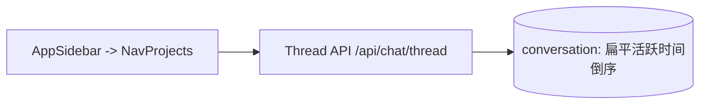
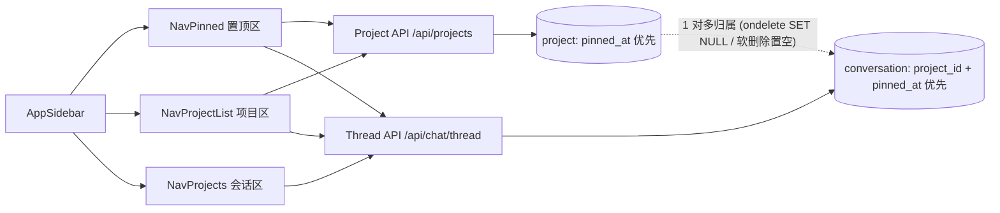

# 会话 Project 与置顶

## 目标

为顶层会话提供 Project 归组、置顶持久化与侧栏分组展示能力：用户可创建、管理自己的 `Project`，将单个未删除的顶层会话归属到一个 `Project` 或移出，对 `Project` 与会话进行置顶，并在左侧边栏通过专属的 Pinned 与 Projects 组件直接操作。

## 能力合同

### 后端与持久化

- 一个 `Project` 归属于单个用户（`uid`），包含极简生命周期字段：`id`（内部自增主键）、`project_id`（对外不可预测的 UUID）、`uid`、`name`、`pinned_at`、`created_at`、`updated_at`、`deleted_at`。
- 一个会话最多归属于一个 `Project`（`conversation.project_id` 关联 `project.project_id`，可空外键 `ondelete="SET NULL"`）；创建普通会话时默认 `project_id = NULL`。
- `Project` 与 `Conversation` 均通过 `pinned_at`（可空时间戳）表达置顶状态与置顶时间顺序，不新建独立置顶表。
- `Project` 软删除时在同一事务内将名下未删除会话的 `project_id` 置空，不删除会话本身。
- `Project` 列表与顶层会话列表均按“置顶优先（`pinned_at DESC NULLS LAST`）+ 最近更新/活跃时间倒序”返回；会话列表支持按 `project_id` 筛选。
- 所有读写与绑定操作均校验 `uid` 归属及目标未软删除，拒绝跨用户引用或绑定已删除的 `Project`。

### 前端侧栏组件

- 在左侧边栏 [app-sidebar.tsx](../../../../web/src/components/app-sidebar.tsx) 的 `SidebarContent` 中按“导航 → Pinned 区域 → Projects 区域 → Conversations 区域”插入专属组件；折叠侧栏（`group-data-[collapsible=icon]:hidden`）时同步隐藏。
- **Pinned 区域组件（`NavPinned`）**：集中展示已置顶的会话与已置顶的 Project（无置顶项时不占位渲染），支持直接跳转与一键取消置顶。
- **Projects 区域组件（`NavProjectList`）**：展示当前用户的 Project 列表，支持新建、重命名、置顶/取消置顶、删除（确认弹窗），并支持展开查看或切换该 Project 下的会话。
- **Conversations 区域（[nav-projects.tsx](../../../../web/src/components/nav-projects.tsx)）**：展示未归属 Project 的会话列表，行内操作菜单补充 `Pin / Unpin` 与 `添加到 / 移出 Project`；在执行置顶、归组、重命名或删除后，与 Pinned、Projects 区域同步状态。
- 所有弹窗、菜单、按钮与图标复用现有 `web/src/components/ui/` 原语与 Lucide 图标，遵循 [docs/frontend/README.md](../../../frontend/README.md)。

## 数据模型与接口契约

### 数据库模型（`src/database/models.py`）

- `Project`（表名 `project`）：
  - `id: Integer` 内部主键自增（不对外暴露）
  - `project_id: String(64)` 唯一索引，非空，对外不可预测 UUID
  - `uid: String(64)` 非空，索引
  - `name: String(255)` 非空
  - `pinned_at: DateTime(timezone=True)` 可空
  - `created_at / updated_at: DateTime(timezone=True)` 非空
  - `deleted_at: DateTime(timezone=True)` 可空
  - 索引：`ix_project_user_list (uid, deleted_at, pinned_at, updated_at, id)`
- `Conversation`（表名 `conversation`）新增列：
  - `project_id: String(64)` 可空，`ForeignKey("project.project_id", ondelete="SET NULL")`，索引
  - `pinned_at: DateTime(timezone=True)` 可空
  - 索引：`ix_conversation_project_list (uid, deleted_at, project_id, pinned_at, updated_at, id)`

### Pydantic 与 HTTP 接口契约

| 接口 | 方法与路径 | 请求 / 查询参数 | 响应要点 |
| --- | --- | --- | --- |
| 创建项目 | `POST /api/projects` | `name: str`（非空去空白，`max_length=255`） | `ProjectResponse`（`project_id`, `name`, `pinned`, `pinned_at`, `created_at`, `updated_at`） |
| 项目列表 | `GET /api/projects` | — | `list[ProjectResponse]`，置顶优先排序 |
| 更新项目 | `PATCH /api/projects/{project_id}` | 可选 `name: str`、`pinned: bool` | `ProjectResponse` |
| 删除项目 | `DELETE /api/projects/{project_id}` | — | `204 No Content`，软删除并清空名下会话 `project_id` |
| 创建会话 | `POST /api/chat/thread` | 原字段 + 可选 `project_id: str \| None` | `ThreadResponse` 新增 `project_id`、`pinned`、`pinned_at` |
| 会话列表 | `GET /api/chat/thread` | 原参数 + 可选 `project_id: str \| None` | `ThreadListResponse`（置顶优先排序 + 兼容游标） |
| 更新会话 | `PATCH /api/chat/thread/{thread_id}` | 原字段 + 可选 `project_id: str \| None`、`pinned: bool` | `ThreadSummaryResponse`（`project_id=null` 表示移出项目） |

- `pinned` 语义：传入 `true` 时写入当前 UTC 时间到 `pinned_at`；传入 `false` 时将 `pinned_at` 置为 `NULL`。
- 列表游标编码：在现有 `(activity_at, conversation_id)` 基础上加入置顶状态与 `pinned_at`，保证跨页翻页顺序稳定。
- 游标版本为 `2`，内容为 `(pinned_at, activity_at, conversation_id)`；`pinned_at=null` 表示未置顶。排序为 `pinned_at DESC NULLS LAST, activity_at DESC, id DESC`。置顶页末尾之后包括更早置顶项及未置顶项；未置顶页末尾之后只查询更早的未置顶项。
- `GET /api/chat/thread` 额外接受 `unassigned=true`（只看未归组）和 `pinned=true/false`（按置顶状态筛选）。省略这些参数时保留全量搜索语义；`project_id` 与 `unassigned=true` 互斥。
- `PATCH` 以实际提交字段为准：省略 `project_id` 保持归属，显式 `null` 移出；显式提交 `pinned=null` 或项目 `name=null` 返回 `422`。项目名称在校验长度前去除首尾空白。
- 项目绑定、更新和软删除在现有请求事务内持有 Project 行锁。目标项目不存在、不属于当前用户或已删除时统一返回 `404`；会话归组操作沿用顶层会话身份校验。

### 前端模块与组件边界

| 模块 / 组件 | 位置 | 职责 |
| --- | --- | --- |
| Project API | `web/src/api/project.ts` | `listProjects`、`createProject`、`updateProject`、`deleteProject` 与 `ProjectResponse` 类型 |
| Thread API | [web/src/api/thread.ts](../../../../web/src/api/thread.ts) | 扩展 `ThreadMetadataResponse`（`project_id`, `pinned`, `pinned_at`）与 `listThreads` / `updateThread` |
| `NavPinned` | `web/src/components/nav-pinned.tsx` | 侧栏 Pinned 专属组件：展示已置顶项目与置顶会话并支持取消置顶 |
| `NavProjectList` | `web/src/components/nav-project-list.tsx` | 侧栏 Projects 专属组件：管理 Project 与展开查看其下会话 |
| `NavProjects` | [web/src/components/nav-projects.tsx](../../../../web/src/components/nav-projects.tsx) | 侧栏 Conversations 列表，增加 `Pin` 与 `Project` 归组菜单动作 |
| `AppSidebar` | [web/src/components/app-sidebar.tsx](../../../../web/src/components/app-sidebar.tsx) | 组合挂载 `NavPinned`、`NavProjectList`、`NavProjects`，协调区域间数据同步 |

`AppSidebar` 保存项目列表、展开的项目 ID 与刷新版本。操作成功后统一刷新项目列表及各会话列表；失败在操作区域显示错误。`NavProjects` 复用同一套分页、菜单和确认弹窗，分别承载未归组会话、指定项目会话和置顶会话。`NavPinned` 在置顶会话前展示已置顶项目，项目点击展开对应项目，会话点击进入原 `/c/:threadId` 路由；两类条目都提供直接取消置顶按钮。各列表独立分页，不依赖全量会话下载。已有自动标题更新事件继续刷新所有已挂载会话列表。

## 改动前后流程

改动前：

改动后：

