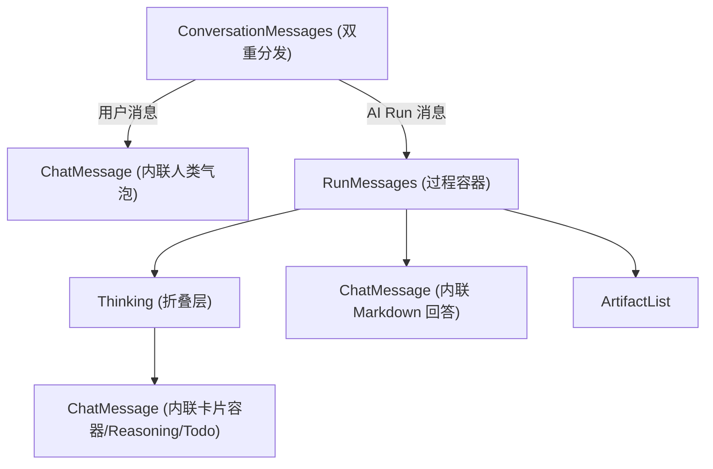
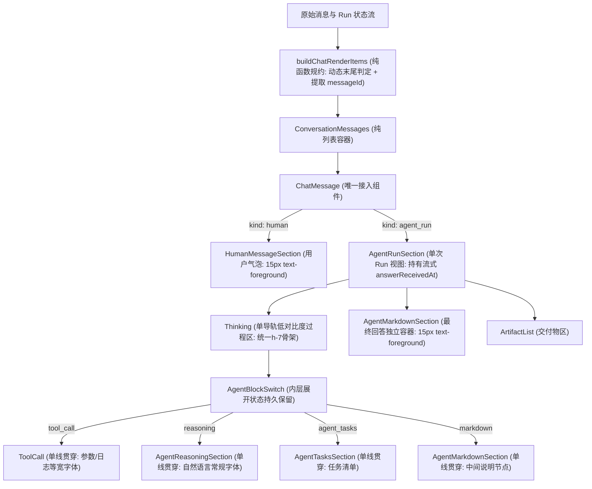

# Chat 消息统一接入与执行过程展示

## 目标

将会话消息流统一由单一入口组件 `ChatMessage` 接入。由数据归约层将扁平消息与运行时状态转换为强类型视图模型，`ChatMessage` 内部通过分支子组件渲染人类气泡、执行过程（`Thinking`）、最终回答（Markdown）与交付物列表（`ArtifactList`）。

## 能力合同

- `ConversationMessages` 作为纯列表容器，通过纯函数 `buildChatRenderItems` 将 `messages` 与当前 Run 状态归约为 `ChatRenderItem[]`，统一渲染 `<ChatMessage item={item} />`。
- 顶层渲染项严格映射后端真实业务模型，仅存在两种合法类型：
  - **`human`（用户提问）**：渲染为右侧气泡，解析 Mention 高亮标签并呈现附件列表。
  - **`agent_run`（单次 Run 执行与回答）**：所有 AI 消息严格归属于具体的 `runId`，顺序包含以下区域：
    - **执行过程区（`Thinking`）**：汇集中间说明、子线程文本、`Reasoning`、`ToolCall` 与 `AgentTasks`。
    - **最终回答区（物理隔离独立容器）**：将 Run 分组末尾的主线程非空文本提取到过程折叠区外独立展示 Markdown 与附件；子线程输出始终留在过程区内。
    - **交付物区（`ArtifactList`）**：汇总当前 Run 产出的沙箱交付物文件卡片，提供预览与下载。
- 完成的纯文本回答不渲染空过程容器；失败、取消、中断状态展示对应状态标签。
- **全链路消息 ID 唯一性（`messageId`）**：所有状态节点与消息块必须严格携带后端传递的 `messageId`，杜绝使用数组索引作为 Key，确保流式增量与 React Diff 稳定。

### 动态流式生命周期与回退机制

- **当前末尾正文与动态回退**：
  - 只有当前快照中 Run 分组序列“最末尾、属于主会话根线程、非空”的文本才暂时置于过程区外的独立回答容器；
  - 若在 Run 活跃期间（`active = true` 且未终态），模型在输出文本后再次触发了新的工具调用或思考链事件，该文本**自动动态回退为过程区时间线内的 `SubText`（中间说明节点）**；
  - 一旦发生回退，`Thinking` 过程区**自动重新展开、恢复 3×3 像素流水动画并恢复实时计时推进**；
  - 只有当 Run 真正到达终态（`completed` / `failed` / `cancelled`）或等待用户交互（`waiting`）时，末尾主线程正文才正式定稿为最终回答。
- **计时与冻结时间来源明确化**：
  - **历史消息（已终态）**：由纯函数直接基于静态时间戳计算。若有最终回答，以回答消息的 `created_at` 与 Run `started_at` 计算耗时；若无回答，以 Run `finished_at` 计算；
  - **活跃 Run（流式进行中）**：由接入组件（`AgentRunSection`）持有 `answerReceivedAt = useRef<number | null>(null)`。在首次观察到当前末尾主线程回答时记录 `Date.now()`；若后续事件导致回答回退为过程文本，**立即将 `answerReceivedAt.current` 重置为 `null` 并恢复计时**；该时刻作为参数显式传给纯函数或耗时计算逻辑。

### 状态区低对比度一致性规范（不喧宾夺主）

过程区（`Thinking`）及所有状态条目（`ToolCall`、`Reasoning`、`AgentTasks`）整体采用**低对比度与统一骨架**，确保视觉重心完全沉淀在最终正文回答上：

1. **颜色与对比度深浅降阶（无 Activate 色）**：
   - **Activate 前后无 Activate Color**：组件处于激活中或未激活、展开或收起状态时，均不采用彩色激活底色或文字高亮；移除 hover/active 灰色高亮色块（`hover:bg-transparent active:bg-transparent aria-expanded:bg-transparent`）；
   - **步骤名称/标题**：使用 `text-[13px] font-medium text-muted-foreground/90`（次级中性灰），禁止使用高对比主色 `text-foreground`；
   - **分隔符与状态说明**：使用竖线 ` | ` 分隔，状态说明使用 `text-[12px] text-muted-foreground/60`（轻浅辅助灰）；
   - **节点图标与折叠箭头**：节点图标统一为 14px（`size-3.5`），展开折叠统一采用 `ChevronsUpDown`，置于最右侧（`ml-auto`），颜色为 `text-muted-foreground/50`；
   - **展开代码与日志细节**：使用淡化背景 `bg-muted/30 text-[11.5px] text-muted-foreground/80`。
2. **统一单行骨架与全行可点触发器**：
   - **布局**：`[ 节点图标 (14px) ] [ 标题名称 (13px) ] | [ 状态文本/摘要 (12px) ]` $\to$ `ml-auto` $\to$ `[ ChevronsUpDown (14px) ]`；
   - **全行触发**：整行均为可点击的展开/折叠项，高度统一为 `h-7`，无额外内边距偏移。
3. **两级展示结构（过程标题与步骤标题左对齐，仅详情缩进）**：
   - **同一条左对齐基线**：`Thinking` 作为折叠容器收纳思考、工具调用与任务清单。展开时内容区域不增加左侧内边距或外边距，各子组件的标题行与 `Thinking` 标题行共享同一条左对齐基线；
   - **沿 Icon 竖线链接与详情缩进**：只有子组件展开后的详情内容（思考全文、参数、日志和工具结果）相对自身标题行向右缩进（`pl-3.5`），且详情区左侧沿上方 Icon 的垂直轴绘制细引导线（`ml-[6.5px] border-l border-border/50`）；步骤标题位置保持不变；
   - **字体严格区隔**：等宽字体（`font-mono`）仅限定用于工具参数（Arguments）、执行输出/进度（Output/Progress）与错误堆栈（Error）；思考全文（`Reasoning`）与过程说明保留自然语言常规段落排版。

### 交互隔离与流式输出规范

- **状态独立解耦**：外层过程容器（`Thinking`）基于生命周期自动折叠/展开，**严禁重置或篡改内层工具和思考链的局部折叠/展开记忆**；内层组件独立控制自身展开状态。
- **思考摘要流式跟随**：思考链（`Reasoning`）未展开时，标题栏摘要随流式文本动态追加更新最后一行；展开后在面板内实时流式追加纯文本全文。
- **流式平滑延续**：平滑流式输出继续由 `useThread` / `useStreamSmoother` 数据驱动层处理，渲染层仅接收响应式状态，组件拆分不改变平滑渲染行为。
- **输出容器物理隔离**：
  - 工具实时日志（`tool-output-delta`）严格输出到对应 `ToolCall` 展开区；思考链（`reasoning_content_delta`）严格输出到 `Reasoning` 内部；严禁外溢到正文区域；
  - 独立正文容器采用最高对比度 `text-foreground`（15px / `leading-6`），完全脱离时间线过程折叠层。

## 数据契约与接口

```ts
export type AgentTodoStatus = "pending" | "in_progress" | "completed";

export interface AgentTodoItem {
  content: string;
  status: AgentTodoStatus;
}

export interface BaseContentBlock {
  messageId: string | number;
}

export interface MarkdownBlock extends BaseContentBlock {
  kind: "markdown";
  content: string;
  attachments: ThreadMessageAttachmentResponse[];
}

export interface ReasoningBlock extends BaseContentBlock {
  kind: "reasoning";
  content: string;
}

export interface ToolCallBlock extends BaseContentBlock {
  kind: "tool_call";
  toolCallId: string;
  name: string;
  status: ToolExecutionStatus;
  index?: number;
  args?: ToolCallArguments;
  output?: JsonValue;
  progress?: string;
  error?: string;
}

export interface AgentTasksBlock extends BaseContentBlock {
  kind: "agent_tasks";
  todos: AgentTodoItem[];
}

export type AgentContentBlock =
  | MarkdownBlock
  | ReasoningBlock
  | ToolCallBlock
  | AgentTasksBlock;

export type ChatRenderItem =
  | {
      kind: "human";
      key: string;
      messageId: string | number;
      content: string;
      attachments: ThreadMessageAttachmentResponse[];
    }
  | {
      kind: "agent_run";
      key: string;
      runId: string;
      threadId?: string;
      status: string | null;
      active: boolean;
      waiting: boolean;
      startedAt: number | null;
      finishTime: number | null;
      processBlocks: AgentContentBlock[];
      answerBlock: MarkdownBlock | null;
      artifacts: PresentedArtifact[];
    };
```

## 流程图

### 改动前（组件入口分裂与嵌套倒置）



### 改动后（单向流水线、状态回退与双态时间契约）


