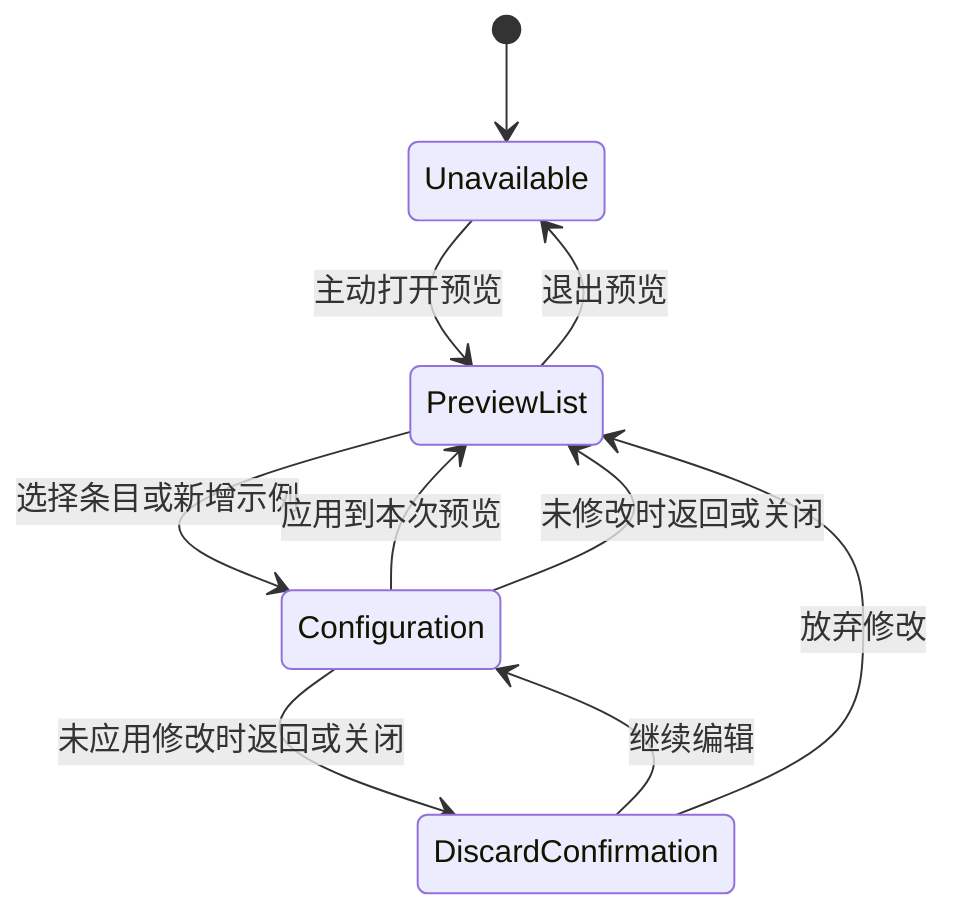

# Settings Skills 与 MCP

## 界面结构

Settings 保留通用、账户和模型，增加 Skills 与 MCP 两个独立入口。默认仍进入通用。
每个新入口以列表为主体；选择条目直接打开配置弹窗，不增加只读详情中间层。

组件使用 `Skill`、`Mcp` 表达已接入项目的设置列表区域，`SkillCard`、`McpCard` 表达单个条目，
`SkillDetail`、`McpDetail` 表达点击条目后打开的配置表单。真实列表在接口未接入时显示明确说明；
本地预览与真实已接入列表分开。
Detail 即配置，不再使用单独的 Edit 组件。列表和弹窗状态由共享协调组件拥有，复用现有 UI 原语。
返回、取消和关闭回到列表，不关闭外层 Settings。配置内容较多时在 Detail 内使用分组页签，
切换分组保留同一份未应用草稿；只展示已有字段、示例文件或明确的限制，不为页签虚构字段。

## 数据边界

现有 Skills 由服务端技能目录提供，MCP 由服务端配置与工具发现服务提供。
当前版本没有对应管理 HTTP API，初始界面必须明确显示该状态，不能把未知列表显示为“未安装”
或“未连接”。初始状态不读取不存在的端点，也不展示虚构的生产记录。

用户可主动打开本地交互预览。预览中持续标注示例数据和不保存到服务端；条目、能力、文件和
工具来自独立的示例定义。编辑只应用于本次预览，不使用“已保存”或“连接成功”反馈。
不接收凭据、不测试真实连接、不安装或执行技能。退出预览、切换设置区域或关闭 Settings 后
清理临时状态；不同账户与两个设置区域的预览互不串用。

## 交互状态

搜索与筛选只处理本地预览；空结果提供清除入口。重复选择、关闭重开、重置和切换区域应保持
一致的状态。未应用修改在返回、取消、Escape 或关闭时需要确认，放弃后不得污染已展示的条目。

弹窗有可访问标题与描述，键盘焦点限制在最上层；Escape 只处理最上层，返回或关闭后恢复到
对应列表条目。原条目因筛选消失时恢复到搜索框。遵守减少动态效果设置。所有字段、状态和
限制提供中英文文案。

## MCP 工具详情

McpDetail 的工具页签展示 ToolCard 列表；点击打开只读 ToolDetail 子弹窗，显示工具用途、
可用的输入/输出 JSON Schema。缺失的用途或 schema 明确显示未提供，不猜测返回内容。
示例元数据仅在主动打开的本地预览中出现，工具不能从此界面执行或连接。
返回、关闭和 Escape 只关闭最上层工具详情，恢复对应 ToolCard 焦点；MCP 配置草稿与当前页签保留。

## 文案

列表或弹窗只保留一条简洁的未接入/本地预览说明，移除重复的介绍与免责声明。
描述用于具体字段、选项、工具用途或元数据未知状态；可编辑的描述字段仍保留。
