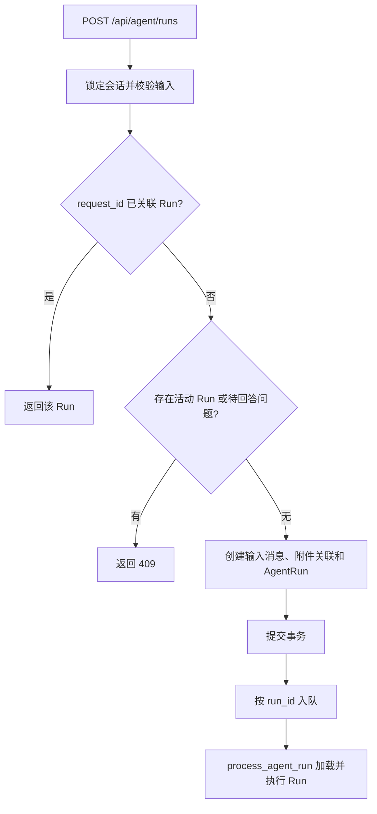
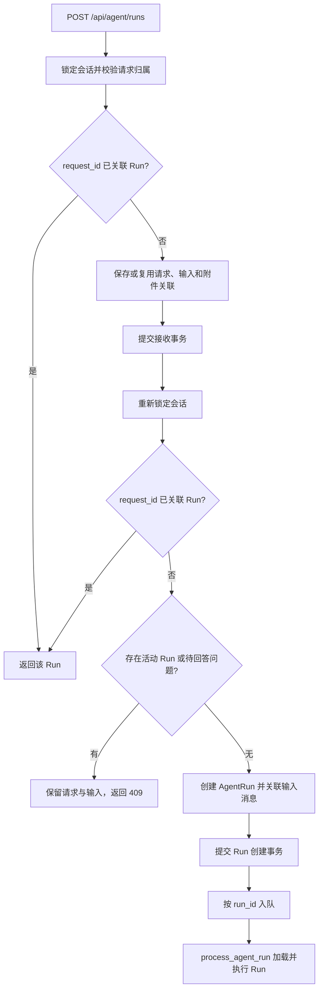

# Agent Run 请求持久化与触发规格

## 1. 能力与职责

`POST /api/agent/runs` 先保存 `AgentRunRequest`，再根据会话中的 Run 状态决定是否创建 `chat` Run。

- PostgreSQL：保存 `AgentRunRequest`、输入消息和 `AgentRun`。
- ARQ：按 `run_id` 派发已提交的 Run。
- Worker：通过 `process_agent_run(run_id)` 加载并执行 Run。

HTTP 请求模型为 `server/entities/agent.py:AgentRunCreateRequest`，数据库模型为 `src/database/models.py:AgentRunRequest`。请求保存和 Run 创建由 `server/service/agent_run_service.py` 编排。恢复请求归 `interrupt-resume`，子代理请求归委派路径。

## 2. 数据契约

### 2.1 AgentRunRequest

字段定义：

```python
class AgentRunRequest(Base):
    __tablename__ = "agent_run_request"

    request_id = Column(String(128), primary_key=True)
    uid = Column(String(64), nullable=False)
    conversation_id = Column(
        Integer,
        ForeignKey("conversation.id", ondelete="CASCADE"),
        nullable=False,
        index=True,
    )
    thread_id = Column(String(64), nullable=False)
    agent_id = Column(String(128), nullable=False)
    trigger_message_id = Column(
        Integer,
        ForeignKey("message.id", ondelete="CASCADE"),
        nullable=False,
    )
    created_at = Column(
        DateTime(timezone=True), nullable=False, server_default=func.now()
    )
```

字段语义：

- `request_id` 取 `request_metadata.request_id`；该值为空时生成 UUID。
- `uid` 取认证用户 UID，`conversation_id` 取该用户所属会话的主键。
- `thread_id`、`agent_id` 保存请求归属。
- 正文、图片和消息元数据分别由 `Message.content`、`Message.image_content`、`Message.msg_metadata` 持有，通过 `trigger_message_id` 读取。
- 会话配置由 `Conversation.conversation_metadata` 持有。接收新请求时，模型选择由 `resolve_chat_model_selection` 解析并由 `resolve_runtime_model` 校验，更新会话的模型字段。
- 创建 Run 时读取会话表当前的元数据与模型，并加入当前 `request_id` 写入 `AgentRun.run_metadata`。请求已保存但尚未创建 Run 时，切换会话模型后重试使用新模型；已创建 Run 的元数据保持其创建时快照。
- `trigger_message_id` 指向接收事务保存的用户输入消息，附件通过 `MessageAttachment` 关联到该消息。
- 请求通过 `request_id` 与 `AgentRun.request_id` 关联。`AgentRun.request_id` 的唯一约束限制每个请求最多关联一个 Run。
- Run 状态从 `AgentRun.agent_status` 读取。

通过 Alembic 创建表。`conversation_id` 和 `trigger_message_id` 的外键使用 `ON DELETE CASCADE`。Service 查询会话时检查用户归属与 `Conversation.deleted_at IS NULL`。

### 2.2 Repository 接口

在 `src/database/repositories/agent_run_request_repository.py` 定义以下类，并从 `src.database.repositories` 导出：

```python
class AgentRunRequestRepository:
    def __init__(self, session: AsyncSession): ...

    async def get_by_request_id(
        self, request_id: str
    ) -> AgentRunRequest | None: ...

    async def create_request(
        self,
        *,
        request_id: str,
        uid: str,
        conversation_id: int,
        thread_id: str,
        agent_id: str,
        trigger_message_id: int,
    ) -> AgentRunRequest: ...

```

Repository 执行查询、插入和 flush；Service 提交事务。Run 的查询、创建及终态写入由 `AgentRunRepository` 执行。

### 2.3 Service 输入对象

`server/service/agent_run_service.py` 定义 `AgentRunRequestInput`，承载创建 Run 业务所需的数据。
Service 从 Repository 返回的 Request 和已锁定的 Conversation 组装该对象：

```python
@dataclass(frozen=True)
class AgentRunRequestInput:
    request_id: str
    uid: str
    conversation_id: int
    thread_id: str
    agent_id: str
    trigger_message_id: int
    conversation_metadata: dict[str, Any]
```

前六个字段来自 `AgentRunRequest`，`conversation_metadata` 来自关联的、未删除的 `Conversation`。
Service 在持有会话行锁时组装输入并创建 Run；Repository 返回 ORM 记录，不依赖 Service 类型。
`ConversationRepository.bind_input_message_to_run`
将 `Message.agent_run_id` 写为新 Run ID。Worker 仍按 `AgentRun.trigger_message_id` 读取 Message，
重建 `AgentInputMsg`。HTTP 请求继续使用 `AgentRunCreateRequest`，表实体与传输对象分别命名。

## 3. 接收与触发规则

### RUN-RD-001 请求先提交

Service 按认证用户锁定会话，确定请求 ID，并按 RUN-RD-004 查询请求与 Run。请求 ID 在两张表中均不存在时，在该事务内执行：

1. 检查用户、会话、Agent、模型和附件，确定模型选择。
2. 保存用户输入消息及附件关联。
3. 保存 `AgentRunRequest` 并关联输入消息。
4. 提交事务。

输入消息的 `agent_run_id` 此时为空。附件复制或接收事务失败时回滚事务，清理复制目标；事务提交后清理复制源。

活动 Run 判断在接收事务提交后进行。因活动 Run 返回 409 时，请求和输入已经提交。

### RUN-RD-002 在会话锁内创建 Run

进入第二个事务，取得该用户所属会话的行锁：

1. 按 `request_id` 查询 Run；存在且通过 RUN-RD-004 的归属检查时返回该 Run。
2. 调用 `get_pending_interaction_run`；存在待回答问题时保留请求，返回 409。
3. 调用 `get_latest_active_for_thread`；存在活动 Run 时保留请求，返回 409。
4. 两项查询均未命中时，用已查询的 Request 和锁定后的 Conversation 组装 `AgentRunRequestInput`，校验会话当前模型，通过 `create_run` 创建状态为 `pending` 的 Run，使用已保存的输入消息 ID 和会话当前元数据。
5. 将输入消息的 `agent_run_id` 设为该 Run ID，提交事务。

活动 Run 指 `agent_status` 不在 `completed/failed/cancelled/interrupted` 集合中的 Run。待回答问题由 `get_pending_interaction_run` 查询。会话行锁覆盖以上步骤，事务提交或回滚时释放。

### RUN-RD-003 提交 Run 后入队

Run 创建事务提交后，Service 调用 `enqueue_agent_run(run_id)`：

- ARQ 函数：`process_agent_run`。
- 参数：`run_id`。
- Job ID：`run:{run_id}`。
- 队列名称：`config.arq_queue_name`。

Run 创建由 Service 执行；Run 加载、认领、execution 创建、输入重建和执行由 `process_agent_run` 处理。

### RUN-RD-004 重复请求

按 `request_id` 查询请求与 Run，检查记录中的 `uid`、`thread_id`、`agent_id` 是否与提交方及请求参数相同；查询到 Run 时，还需检查 `run_type == "chat"`。

- 归属检查通过且 Run 存在：返回该 Run。
- 归属检查通过且只有请求存在：复用保存的请求及输入，进入 RUN-RD-002。
- 归属检查未通过：返回 409，`detail` 为 `request_id 已被其他请求使用`。

重复提交复用首次保存的输入消息，忽略重发的正文、图片、消息元数据和模型选择；尚无 Run 时从会话表读取当前配置。同一会话的请求保存和 Run 创建分别在会话行锁内执行；请求表主键限制每个请求 ID 只能有一条记录，`AgentRun.request_id` 唯一约束限制每个请求最多关联一个 Run。

### RUN-RD-005 失败边界

| 失败位置 | 已提交的数据 | 处理 |
| --- | --- | --- |
| 接收事务失败 | 本次请求和输入均未提交 | 回滚并传播错误，清理本次复制目标 |
| 活动 Run 或待回答问题阻止创建 | 请求、输入和附件关联 | 保留数据，返回 409 |
| Run 创建事务失败 | 请求及输入 | 回滚 Run 创建事务，传播错误 |
| 入队失败 | 请求、输入和 Run | 调用 `set_agent_terminal(status="failed")`，写入 `error/error_type` 并提交 |

入队失败的终态写入只作用于尚未认领且状态为 `pending/queued` 的 Run。Run 创建事务回滚或入队失败时，已提交的请求、输入和附件关联保留。

## 4. HTTP 接口

请求结构为 `AgentRunCreateRequest`，接口地址为 `POST /api/agent/runs`。

创建 Run 或查到请求关联的 Run 时，HTTP 200 响应为：

```json
{
  "run_id": "<run.id>",
  "thread_id": "<run.thread_id>",
  "status": "<run.agent_status>",
  "request_id": "<run.request_id>",
  "stream_url": "/api/agent/runs/<run.id>/events?thread_id=<run.thread_id>"
}
```

会话阻止 Run 创建时，返回 HTTP 409：

| 条件 | `detail` |
| --- | --- |
| 存在活动 Run | `当前会话有正在执行的任务` |
| 存在待回答问题 | `当前会话有待回答的问题` |

以上两个分支返回时，请求和输入已提交，该请求尚未关联 Run。响应只包含 `detail`。

## 5. 流程图

### 改动前



### 改动后



## 6. 验收标准

- Run 创建事务回滚或入队失败后，按 `request_id` 能查到请求及输入消息。
- 调用 `enqueue_agent_run` 时，另一个数据库会话能读取请求、Run 及其输入消息。
- 存在活动 Run 或待回答问题时返回 409；该请求的记录数为 1，关联 Run 数为 0，入队调用次数为 0。
- 同一请求重复提交后，请求记录数为 1，输入消息数为 1，关联 Run 数最多为 1。
- 同一会话并发触发时，Run 创建事务通过会话锁串行执行；因活动 Run 返回 409 的请求记录保留。
- 入队失败时，尚未认领的 Run 写入 `failed` 和 `error/error_type`；ARQ Job 参数为 `run_id`。
- 迁移升级创建请求表，回退删除请求表；Run 的查询与执行不依赖请求表记录。
