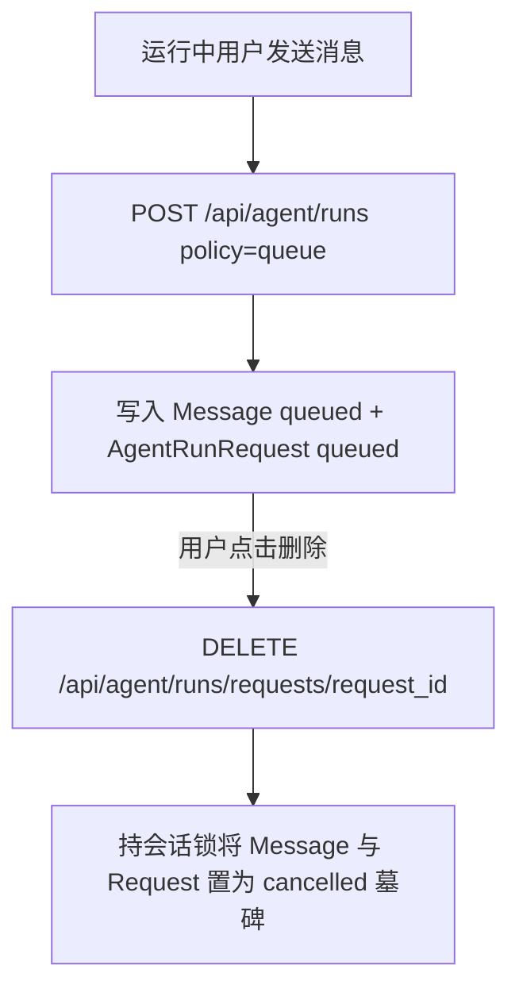
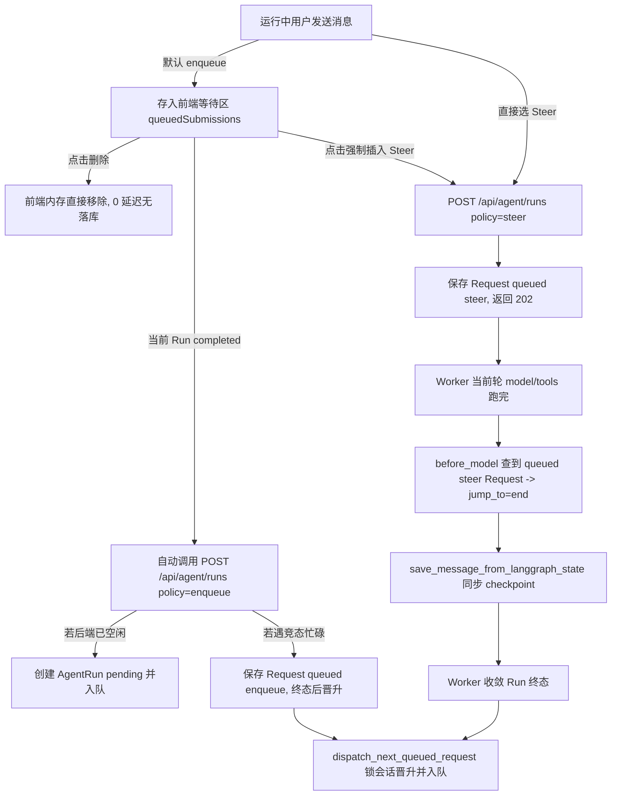

# Agent Run 分发策略与前端等待区规格

## 1. 能力与职责

`POST /api/agent/runs` 按 `dispatch_policy`（`enqueue | reject | steer`，默认 `enqueue`）接收并持久化 `AgentRunRequest`，根据会话中的 Run 状态决定立即创建 `AgentRun`、进入后端排队（普通排队或转向排队）或拒绝请求；桌面端运行中默认通过**前端未发送请求包**承载交互等待区。

- **前端等待区（未发送包）**：当会话存在活动 Run 时，用户以 `enqueue` 模式发送的消息（正文与已上传附件引用）仅暂存在前端等待区列表（`QueuedSubmission`），不发往后端落库，支持 0 延迟本地移除、一键转为 `steer` 强制插入，以及在当前 Run 正常完成（`completed`）后以 `dispatch_policy="enqueue"` 自动发出（并在终态竞态窗口下由后端 `enqueue` 兜底接住）。
- **PostgreSQL**：持有已提交的 `AgentRunRequest`（`dispatched` 或 `enqueue` / `steer` 排队态）、输入 `Message` 与 `AgentRun`；`uq_agent_run_one_executing_per_thread` 保证同一 `thread_id` 至多存在一个执行中 `AgentRun`。
- **ARQ**：只派发已晋升为 `AgentRun(agent_status="pending")` 的任务，`enqueue_agent_run(run_id)` 契约保持不变。
- **Worker / Runtime**：执行 Run、响应 `steer` 软停止（Turn 边界 `jump_to="end"`）与硬取消，收敛输出消息与 Run 终态后，触发下一条 `queued` 请求晋升。

HTTP 请求模型为 `server/entities/agent.py:AgentRunCreateRequest`，数据库模型为 `src/database/models.py:AgentRunRequest`。请求保存与晋升由 `server/service/agent_run_service.py` 编排；Turn 边界停机与消息收敛由 `src/agents/middlewares/`、`server/service/thread_service.py` 与 `server/worker.py` 协作完成。

## 2. 数据契约

### 2.1 HTTP 请求模型：`AgentRunCreateRequest`

```python
class AgentRunCreateRequest(BaseModel):
    query: str | None = Field(default=None, description="问题")
    agent_id: str = Field(default=..., description="Agent 标识")
    thread_id: str = Field(default=..., description="对话 thread_id")
    dispatch_policy: Literal["enqueue", "reject", "steer"] = "enqueue"
    request_metadata: dict[str, Any] = Field(
        default_factory=dict,
        description="请求元数据：type（chat/resume）、model、request_id、attachment_file_ids、resume.answers",
    )
    image_content: str | None = Field(default=None, description="图像文件")
```

### 2.2 数据库模型：`AgentRunRequest` 与 `Message`

```python
class AgentRunRequest(Base):
    __tablename__ = "agent_run_request"
    __table_args__ = (
        Index(
            "ix_agent_run_request_thread_queued",
            "thread_id",
            "queue_seq",
            postgresql_where=text("status = 'queued'"),
        ),
    )

    request_id = Column(String(128), primary_key=True)
    uid = Column(String(64), nullable=False)
    thread_id = Column(String(64), nullable=False, index=True)
    agent_id = Column(String(128), nullable=False)
    trigger_message_id = Column(
        Integer,
        ForeignKey("message.id", ondelete="CASCADE"),
        nullable=False,
    )
    dispatch_policy = Column(String(16), nullable=False, server_default="enqueue")
    status = Column(String(16), nullable=False, server_default="dispatched")
    queue_seq = Column(Integer, nullable=True)
    created_at = Column(
        DateTime(timezone=True), nullable=False, server_default=func.now()
    )
```

字段语义：

- `thread_id`：逻辑对应 `Conversation.thread_id`（由 Service 层持会话锁校验归属与 `deleted_at IS NULL`）；会话物理删除时通过 `trigger_message_id -> message.id (ON DELETE CASCADE)` 自动级联清除。
- `dispatch_policy`：取自请求的 `enqueue | reject | steer`，默认 `enqueue`。
- `status`：仅允许 `queued | dispatched`：
  - `queued`：会话忙碌时按 `enqueue`（静默等待当前 Run 收敛后晋升）或 `steer`（触发 `before_model` Turn 边界优雅停机后晋升）入队。
  - `dispatched`：已绑定 1:1 `AgentRun`（`AgentRun.request_id == AgentRunRequest.request_id`）。
- `queue_seq`：仅当 `enqueue` 或 `steer` 请求进入等待晋升态时按同一 `thread_id` 单调递增分配，决定晋升顺序（`queue_seq ASC`）。
- `trigger_message_id` 对应的用户输入 `Message`：
  - 立即执行（`dispatched`）时，`Message.status = "completed"` 并绑定 `agent_run_id = run.id`。
  - 后端等待晋升（`queued`）时，`Message.status = "queued"`、`Message.agent_run_id = None`；主消息历史查询过滤 `status = "queued"` 的记录。晋升为 `AgentRun` 时将 `Message.status` 置为 `"completed"`、重新分配当前最大 `sequence` 并绑定 `agent_run_id`。

### 2.3 Repository 接口

`src/database/repositories/agent_run_request_repository.py:AgentRunRequestRepository` 提供：

```python
class AgentRunRequestRepository:
    def __init__(self, session: AsyncSession): ...

    async def get_by_request_id(self, request_id: str) -> AgentRunRequest | None: ...

    async def create_request(
        self,
        *,
        request_id: str,
        uid: str,
        thread_id: str,
        agent_id: str,
        trigger_message_id: int,
        dispatch_policy: str,
        status: str,
        queue_seq: int | None = None,
    ) -> AgentRunRequest: ...

    async def get_next_queue_seq(self, thread_id: str) -> int: ...

    async def has_queued_steer_for_thread(self, thread_id: str) -> bool: ...

    async def has_expired_steer_for_run(self, run_id: str, *, grace_seconds: float) -> bool: ...

    async def pop_next_queued_for_thread(
        self, thread_id: str
    ) -> AgentRunRequest | None: ...

    async def mark_dispatched(self, request_id: str) -> None: ...
```

## 3. 分发策略与状态规则

### RUN-RD-001 请求接收与策略路由

Service 在持有用户所属 `Conversation` 行锁（`for_update=True`）后执行 `request_id` 幂等检查（RUN-RD-005）。新请求按以下规则处理：

1. 查询 `get_pending_interaction_run(thread_id)`：若存在未回答的 `ask_user` 中断 Run，所有策略（`enqueue | reject | steer`）均返回 HTTP 409（`detail: 当前会话有待回答的问题`），**不**提交孤立的 user `Message`。
2. 查询 `get_latest_active_for_thread(thread_id)`：
   - **会话空闲（无活动 Run）**：保存 `Message(status="completed")`、`MessageAttachment`、`AgentRunRequest(status="dispatched")`，创建 `AgentRun(agent_status="pending")` 并绑定 `Message.agent_run_id`，提交事务后调用 `enqueue_agent_run(run.id)`。
   - **会话忙碌且 `dispatch_policy == "reject"`**：不写入 `Message` 与 `AgentRunRequest`，直接返回 HTTP 409（`detail: 当前会话有正在执行的任务`）。
   - **会话忙碌且 `dispatch_policy == "enqueue"`（默认）**：保存 `Message(status="queued")` 与 `AgentRunRequest(status="queued", dispatch_policy="enqueue", queue_seq=next_seq)`，提交后返回 HTTP 202（`status="queued"`、`dispatch_policy="enqueue"`、`steering_run_id=None`）；不触发转向停机或宽限硬取消，待当前 Run 收敛终态后自动晋升。
   - **会话忙碌且 `dispatch_policy == "steer"`**：保存 `Message(status="queued")` 与 `AgentRunRequest(status="queued", dispatch_policy="steer", queue_seq=next_seq)`，提交后返回 HTTP 202（`status="queued"`、`dispatch_policy="steer"`、`steering_run_id=active_run.id`），触发 Turn 边界停机。

### RUN-RD-002 Run 创建与终态晋升

1. **直接创建**：会话空闲时创建 `AgentRun(agent_status="pending")`、回绑 `Message.agent_run_id`，提交后调用 `enqueue_agent_run(run.id)`。
2. **终态晋升（`dispatch_next_queued_request(thread_id)`）**：
   - 在 `server/worker.py` 将活跃 `AgentRun` 收敛为 `completed | failed | cancelled` 终态（含租约过期回收器收敛 `LeaseExpired`）**之后**调用。
   - 持有 `Conversation(thread_id)` `FOR UPDATE` 行锁，确认 `get_pending_interaction_run` 与 `get_latest_active_for_thread` 均为 `None`。
   - 按 `queue_seq ASC` 取出最早一条 `AgentRunRequest(status="queued")`（覆盖 `enqueue` 与 `steer`）。
   - 将关联 `Message` 置为 `status="completed"`、更新为新 `sequence`，创建 `AgentRun(agent_status="pending")` 并绑定 `agent_run_id`，将 `AgentRunRequest.status` 更新为 `"dispatched"`，提交事务后调用 `enqueue_agent_run(run.id)`。

### RUN-RD-003 Steer 优雅停机（Turn 边界 `jump_to="end"`）

1. **核心边界**：活跃 Run 正在执行 `model` 流式输出或 `tools` 调用时，不强行向进行中节点注入 `HumanMessage`，也不直接硬杀正常工具调用；等当前轮的 `model -> tools` Superstep 闭环并提交 checkpoint 后，在下一轮 `before_model` 节点完成退出。
2. **单一事实来源**：直接复用 PostgreSQL `AgentRunRequest` 表作为唯一状态来源，不向 Redis 写入额外信号；`enqueue` 请求不匹配 `steer` 条件。
3. **Graph 退出路径**：`LeaderAgent` 装配 `SteerStopMiddleware`（`before_model(can_jump_to=["end"])`）。进入下一轮 `before_model` 前查询当前会话是否存在 `status == "queued"` 且 `dispatch_policy == "steer"` 的 `AgentRunRequest`；命中时返回 `{"jump_to": "end", "steered_run_id": runtime.context.run_id}`，图路由至 `after_agent -> END`，完整保留上一个 `AIMessage(tool_calls)` 与 `ToolMessage` 配对。
4. **终态收敛与硬取消兜底**：
   - 图跳至 `END` 正常结束 `astream_events` 后，先执行消息保存收敛，再由 Worker 结合 `has_queued_steer_for_thread(thread_id)` 将当前 Run 收敛为 `cancelled`（标记被转向的终止原因），随后调用 `dispatch_next_queued_request(thread_id)` 晋升新请求。
   - 若工具执行耗时超过宽限阈值或用户点击显式强停，仍由 `_cancellable_stream` 触发 `asyncio.CancelledError` 硬取消兜底。

### RUN-RD-004 非正常 / Steer 消息保存收敛

取消或转向退出时，`server/service/thread_service.py` 的消息持久化遵循单一收敛顺序：

1. 先执行 `save_message_from_langgraph_state`，将当前 Run 内**已提交进 LangGraph checkpoint** 的全部 `AIMessage`（通过 `ModelMessageAuditRepository.reconcile_to_history` 转正流式审计行）与 `ToolMessage`（更新 `ToolCall` 结果）落库。
2. 仅当硬取消或异常中断发生在流式半途中、存在尚未进入 checkpoint 的 `accumulated_msg` 时（`stream_agent_response` 与 `resume_agent_response` 均须传入 `full_msg`），优先按当前 `operation_id` 对 `model_audit` 行执行 reconcile 并附加中断元数据；不存在对应审计行时才写入截断消息。
3. 若因 `before_model` 跳 `END` 退出且最后一条 `AIMessage` 仅为工具调用前置消息，在 Run/Message 元数据保留 `stop_reason="steered"`，不重复插入多余文本消息。

### RUN-RD-005 重复请求幂等

按 `request_id` 查询 `AgentRunRequest` 与 `AgentRun`，核对 `uid`、`thread_id`、`agent_id`：

- 已绑定 `AgentRun`：返回该 Run（HTTP 200）。
- 状态为 `queued`：返回当前排队态（HTTP 202；`enqueue` 时 `steering_run_id` 为 `null`，`steer` 时为当前活跃 Run ID）。
- 归属校验失败：返回 HTTP 409（`detail: request_id 已被其他请求使用`）。

### RUN-RD-006 前端未发送等待区

`web/src/pages/chat/ChatPage.tsx` 持有当前会话的未发送等待队列 `queuedSubmissions`：

1. 当 `run.isActive()` 为真且用户以默认 `enqueue` 模式提交时，输入正文与已上传附件存入 `queuedSubmissions`，清空编辑器，不调用后端接口。
2. 等待区每条记录支持：
   - **Remove（删除）**：直接从前端 `queuedSubmissions` 移除，0 网络延迟、无后端调用。
   - **Steer（强制插入）**：从前端 `queuedSubmissions` 取出并以 `dispatch_policy="steer"` 调用 `POST /api/agent/runs`。
3. 当前活动 Run 正常结束（`endEvent.status === "completed"` 且无 `pendingInteraction`）时，自动弹出队首记录并以 `dispatch_policy="enqueue"` 调用 `POST /api/agent/runs` 发起新 Run（并在终态并发窗口下由后端 `enqueue` 策略兜底接住）。

## 4. HTTP 接口

### 4.1 提交请求：`POST /api/agent/runs`

- **立即创建或已关联 Run（HTTP 200）**：

```json
{
  "run_id": "<run.id>",
  "thread_id": "<run.thread_id>",
  "status": "<run.agent_status>",
  "request_id": "<run.request_id>",
  "stream_url": "/api/agent/runs/<run.id>/events?thread_id=<run.thread_id>"
}
```

- **接受后端排队（`enqueue`）或转向等待（`steer`）（HTTP 202）**：

```json
{
  "run_id": null,
  "thread_id": "<request.thread_id>",
  "status": "queued",
  "dispatch_policy": "enqueue",
  "request_id": "<request.request_id>",
  "steering_run_id": null,
  "stream_url": null
}
```

当 `dispatch_policy` 为 `"steer"` 时，`steering_run_id` 为 `"<active_run.id>"`。

## 5. 流程图

### 改动前



### 改动后



## 6. 验收标准

- 会话运行中前端默认 `enqueue` 发送进入前端等待区，不触发后端请求与数据库写入；点击删除立即从前端移除。
- 当前 Run 正常完成后，前端自动以 `dispatch_policy="enqueue"` 发送等待区队首请求并订阅新 Run。
- `POST /api/agent/runs` 默认 `dispatch_policy="enqueue"`：会话忙碌时持久化等待并在旧 Run 收敛终态后自动晋升，不中断当前 Run。
- `dispatch_policy="reject"` 在会话忙碌时返回 409 且不产生孤立 `Message` 与 `AgentRunRequest`。
- `dispatch_policy="steer"` 在当前轮 `tools` 执行完进入下一轮 `before_model` 时通过 `jump_to="end"` 优雅停机，checkpoint 内 `AIMessage` 与 `ToolMessage` 完整配对，随后自动晋升执行新请求。
- 非正常退出（Turn 边界停机或硬取消）均先同步已提交 checkpoint 的消息与 `ToolCall` 结果，半截流式输出优先 reconcile 已有 `model_audit` 行，且 `resume_agent_response` 保留部分输出。
- `enqueue_agent_run(run_id)` 契约保持不变，仅在 `AgentRun` 创建提交后被调用。
