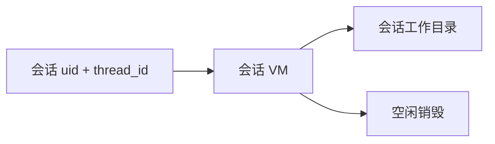
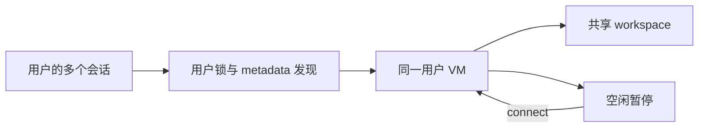

# CubeSandbox Runtime Spec

状态：现行目标契约；应用实现和 Compose 配置已落地，目标 Ubuntu 运行验收待执行。

## 1. 目标与范围

在同一台 Ubuntu 主机上，用 Docker Compose 编排应用与 CubeSandbox，替换当前 Docker
沙盒供应服务。已知主机配置是 32GB 内存、200GB SSD；CPU 架构、核心数、KVM、Ubuntu
版本、文件系统和可用磁盘空间尚待预检。

第一版覆盖创建、重连、命令执行、文件操作、前端工作区访问、超时回收和进程重启恢复。
非目标：多节点调度、在线模板编辑器、自动快照/恢复策略、新的沙盒管理页面、多个沙盒后端并存。

## 2. 需求

### SB-CUBE-001 部署与执行边界

Compose 管理 Cube 控制服务、计算节点容器及必要的初始化服务；执行环境由 Cube 的 MicroVM
提供。API/Worker 通过 SDK 调用 Cube，不持有 Docker Socket，也不在应用进程中启动 VM。
正式切换后删除原供应服务路径及依赖。宿主机内核、设备、网络和 XFS 条件先于运行验收。

初始化应可重复执行，保留已有实例、模板和工作目录。正常 `compose up` 不格式化宿主机磁盘、
安装 PVM 内核或重启主机。首次主机准备与日常启动分开。

### SB-CUBE-002 地址与网络

API/Worker 使用 Compose 内的 CubeAPI 地址管理生命周期，使用 CubeProxy 访问实例内的命令
和文件服务；通过 CubeMaster 的单节点 inventory 严格查询会话实例。各入口分别配置、分别验证。
浏览器继续调用项目 API。

计算节点使用宿主机网络时，其访问地址必须从宿主机视角配置；控制服务回连节点使用可达的
节点地址，不能把 Compose 服务 DNS、宿主机 localhost 与 VM 地址混用。

Cube 控制接口仅供受信任服务访问。VM 出站策略阻止访问应用数据库、队列和 Cube 管理接口。
配置一个 SDK API key 本身不等于开启 CubeAPI 鉴权。

### SB-CUBE-003 用户归属与绑定

业务数据库不保存 Cube 实例 ID。通过 `app=agent-stack, scope=user, uid` metadata 发现用户
实例；同一用户的所有会话和子会话复用 VM。LangGraph state 和进程缓存仅保存可重建引用。
Cube 拥有 VM 状态，Agent backend 不访问业务数据库。

工作区 API 保留会话归属校验，再按 uid 获取用户实例。跨 API/Worker 使用同一用户 Redis 锁
串行化查询、重连与创建；锁不保存实例绑定。重复匹配、节点不可达或查询不完整时拒绝创建。
旧版带 thread_id 的实例不参与用户级匹配，仍可显式销毁。

只有 Cube 明确返回不存在才重建；鉴权失败、网络超时和 5xx 不触发第二个实例。

### SB-CUBE-004 按需获取与恢复

首次使用命令/文件工具时获取实例，应用启动及纯对话不创建 VM。每次工具调用重新发现并
connect；暂停实例通过 connect 恢复原 ID，API/Worker 重启后同样可以发现它。
实例被明确销毁后，新实例重新挂载用户工作目录；命令发出后不自动重放。

### SB-CUBE-005 工作目录

用户工作目录对应 `SAVE_DIR/workspaces/<uid>`，Host Mount 将
`CUBE_HOST_SAVE_DIR/workspaces/<uid>` 挂到 VM `/workspace`；所有聊天共享文件，
产物目录为 `/workspace/outputs`。旧会话文件不搬移，继续位于 `/workspace/<thread_id>`。
Composite 文件路由、产物解析和工作区 API 使用同一用户根目录。

技能目录在 `/skill` 只读挂载。同一用户必须使用相同技能挂载配置；配置不同则报挂载摘要
不一致，不能静默替换正在使用的 VM。Host Mount 只接受部署允许的共享目录，校验
uid/thread_id 路径段与符号链接。不同用户工作目录与 VM 隔离，同一用户聊天不提供文件隔离。

销毁 VM 保留宿主机工作文件；VM 内安装的依赖随暂停保留，显式销毁后需重新安装。

### SB-CUBE-006 工具协议

沿用 DeepAgents BackendProtocol 和现有前端工作区响应结构。Cube 适配器实现命令执行、ID、
二进制上传下载，普通 ls/read/write/edit/grep/glob 优先复用已安装的 BaseSandbox。

命令结果保留退出码、stdout/stderr 与超时错误。用户可见执行输出可以截断；内部文件操作的
结构化输出不可在解析前截断。下载必须返回完整字节，不能将分页文本或截断的 base64 当成文件。
上传/下载逐文件报告成功和错误。

### SB-CUBE-007 生命周期

采用有限空闲超时，到期由 Cube 暂停 VM，生命周期设置为
`onTimeout=pause, autoResume=false`。应用通过 connect 显式恢复；单次命令时限短于空闲 TTL。
release 仅释放本地使用引用，最后一个使用者退出才关闭 SDK；Agent 结束或应用关闭不删除 VM。

远端 destroy 与创建使用同一用户锁串行执行；404 视为已销毁。下一次获取重新创建并挂载原
工作目录。Run 取消不杀掉其他聊天使用的 VM，已发出的命令仍受远端进程时限约束。

### 获取流程

变更前：

变更后：

### SB-CUBE-008 验证边界

静态检查、SDK 单测、Compose 配置展开、真实 Ubuntu 主机运行分别记录。
只有 Linux 上完成创建、命令、文件、前端读取、跨进程重连、并发创建和回收验证，才算替换完成。

### SB-CUBE-009 工作区文件操作

Sandbox 工作区使用桌面三段式布局：左侧文件树、中间文件 item 区域、右侧推拉式预览与编辑
drawer。界面保持扁平，不增加手机布局、路径说明或额外解释性文字。

Sandbox 文件 item 使用 shadcn 下拉菜单提供重命名、编辑内容和删除；目录仅提供打开操作。
重命名和删除使用 Dialog，删除必须确认。文本编辑在右侧预览 drawer 内完成，提供保存和取消。
操作失败保留输入并显示错误，成功后刷新当前目录；删除当前预览文件时关闭 drawer，重命名时
同步预览名称与路径。

所有操作先验证会话归属，再通过当前 Cube backend 访问 `/workspace` 内的普通文件。拒绝目录、
符号链接和越界路径；重命名限定同目录文件名，并拒绝覆盖已有目标。文件编辑只接受完整 UTF-8
文本，保留换行格式；保存携带读取时的完整内容，内容已变化时返回 409 并保留用户草稿。
读取超过 2,000 行或 200,000 字符的编辑内容时标记截断，前端禁止保存截断文本。

| 接口 | 行为 |
| --- | --- |
| `GET /api/sandbox/workspace/content?thread_id=…&path=…&editable=true` | 完整编辑文本与截断标记，保留末尾换行 |
| `POST /api/sandbox/workspace/rename` | 接收 `thread_id/path/name`，返回新 `path` |
| `PUT /api/sandbox/workspace/content` | 接收 `thread_id/path/content/previous_content`，成功返回 204 |
| `DELETE /api/sandbox/workspace/file?thread_id=…&path=…` | 删除普通文件，成功返回 204 |

原有目录列表与默认预览接口保持现有响应结构。文件不存在返回 404，非法输入返回 422，
同名目标或保存冲突返回 409，Cube 操作失败返回 502。远端文件调用结束后归还连接引用。
